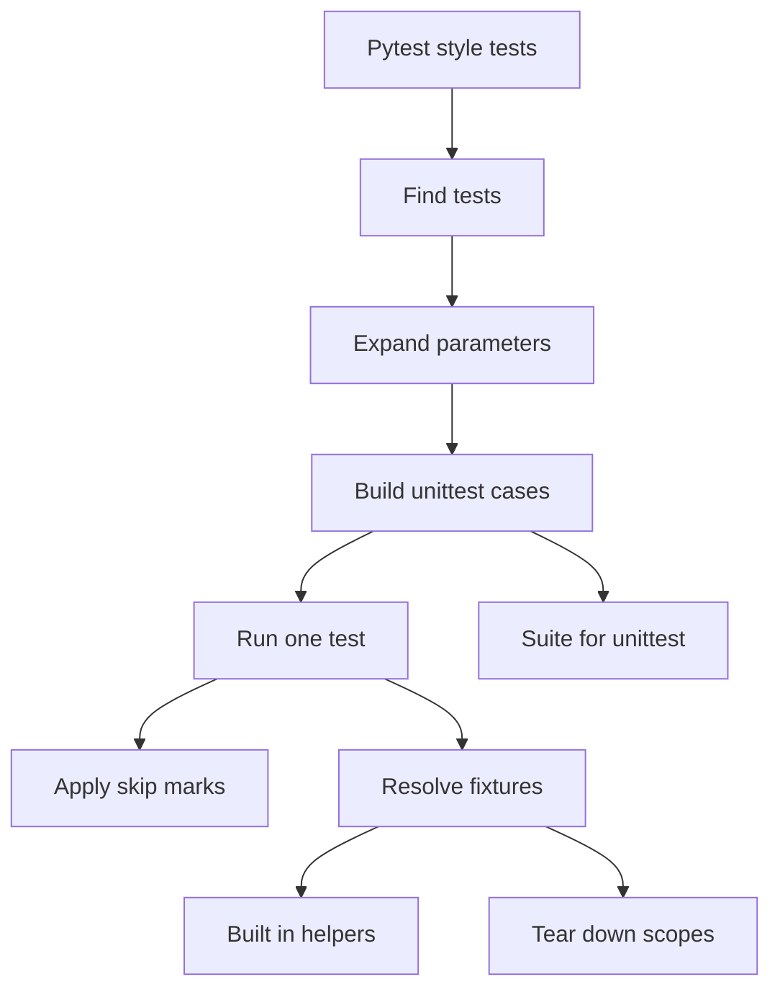
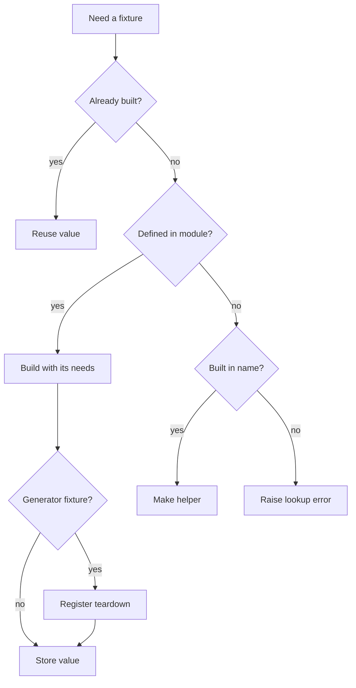

## Purpose

This module is a small stand-in for the parts of `pytest` that the state script tests use, so those tests can run with the standard library alone. It supplies the markers, fixtures, `raises`, and the built-in helpers (`tmp_path`, `monkeypatch`, `capsys`, `caplog`), plus a runner that turns each pytest-style test into a `unittest` case. The state tests import it under the name `pytest`.

## Dependencies

**Depends on.** Standard library only: `contextlib`, `functools`, `inspect`, `io`, `itertools`, `logging`, `os`, `re`, `shutil`, `sys`, `tempfile`, `unittest`, `collections`, `pathlib` {src:tests/scripts/state/minipytest.py:15-28}. It needs no other file in the repo and no environment variable.

**Used by.** Product code: none (searched `git grep -n "minipytest"` outside `docs/` on 2026-11-20; every hit is under `tests/scripts/state/`). Tests, each on its own line:
- `test_pytest_bridge.py` imports it and calls `make_cases` {src:tests/scripts/state/test_pytest_bridge.py:27} {src:tests/scripts/state/test_pytest_bridge.py:31}.
- `test_vault_census.py`, `test_backfill_vault_frontmatter.py`, `test_backfill_ticket_policy.py` and `test_backfill_nonticket_policy.py` import it as `pytest` {src:tests/scripts/state/test_vault_census.py:31} {src:tests/scripts/state/test_backfill_vault_frontmatter.py:39} {src:tests/scripts/state/test_backfill_ticket_policy.py:41} {src:tests/scripts/state/test_backfill_nonticket_policy.py:29}.

## Behavior

**Markers and helpers.**
- `skip(reason)` raises `unittest.SkipTest` {src:tests/scripts/state/minipytest.py:43-44}. `fail(reason, pytrace)` raises `AssertionError` and ignores `pytrace` {src:tests/scripts/state/minipytest.py:47-48}.
- `param(*values, id=None)` wraps values for one parameter set {src:tests/scripts/state/minipytest.py:39-40}.
- `mark.parametrize` stores the argument names, values and ids on the function {src:tests/scripts/state/minipytest.py:52-56}. `mark.skipif` stores the condition and reason {src:tests/scripts/state/minipytest.py:58-62}. Any other mark name returns a decorator that does nothing, so a mark such as `xfail` has no effect {src:tests/scripts/state/minipytest.py:64-69}.
- `fixture` works with or without arguments and records only `scope` and `autouse`; any other keyword (for example `params`) is accepted and dropped {src:tests/scripts/state/minipytest.py:75-81}.
- `raises(expected, match=None)` is a context manager that fails with `did not raise` when nothing is raised, and with a text mismatch when `match` does not match `str(exc)` by `re.search` {src:tests/scripts/state/minipytest.py:90-101}.

**Built-in helpers.**
- `MonkeyPatch` records every change and `undo` reverses them last in, first out {src:tests/scripts/state/minipytest.py:165-185}. `setattr` needs three arguments, so the string-target form of real pytest raises `TypeError` {src:tests/scripts/state/minipytest.py:121-123}, and a missing attribute raises unless `raising=False` {src:tests/scripts/state/minipytest.py:124-126}. It also offers `delattr`, `setitem`, `delitem`, `setenv`, `delenv`, `chdir` and `syspath_prepend` {src:tests/scripts/state/minipytest.py:130-163}, and a `context()` class method for a short-lived patcher {src:tests/scripts/state/minipytest.py:112-119}.
- `CaptureFixture` swaps `sys.stdout` and `sys.stderr` for in-memory buffers when it is created {src:tests/scripts/state/minipytest.py:193-196}. `readouterr()` returns the text so far and clears the buffers {src:tests/scripts/state/minipytest.py:201-207}. `close()` puts the saved streams back {src:tests/scripts/state/minipytest.py:209-210}.
- `LogCaptureFixture` attaches a list handler to the root logger {src:tests/scripts/state/minipytest.py:226-228}. It exposes `records`, `text`, `messages` and `record_tuples` {src:tests/scripts/state/minipytest.py:231-246}, and `at_level` sets a logger level for a block and restores it {src:tests/scripts/state/minipytest.py:256-264}. The handler itself accepts every level {src:tests/scripts/state/minipytest.py:215}, but the root logger keeps its own level unless a test raises it.
- `TempPathFactory` makes one `mkdtemp` folder with the prefix `minipytest-` and numbered sub-folders {src:tests/scripts/state/minipytest.py:274-281}. `close()` removes the whole tree {src:tests/scripts/state/minipytest.py:283-284}. One factory is shared by the whole process and removed at exit {src:tests/scripts/state/minipytest.py:303-313}.

**Finding tests.** `collect(module)` lists functions named `test*` and classes named `Test*` that are defined in that module (not imported), sorted by source line {src:tests/scripts/state/minipytest.py:377-386}. Only methods in the class's own `vars` are taken, so a test method inherited from a base class is not found {src:tests/scripts/state/minipytest.py:384-386}. `expand_params` builds one entry per parameter set, and stacked `parametrize` marks multiply into a product {src:tests/scripts/state/minipytest.py:401-430}. A case id comes from `param(id=)`, then `ids`, then the joined values when all are simple types, else `p<index>` {src:tests/scripts/state/minipytest.py:417-422}.

**Running one test.** `run_one` raises `SkipTest` for a true `skipif` condition {src:tests/scripts/state/minipytest.py:437-440}, resolves every autouse fixture {src:tests/scripts/state/minipytest.py:446-448}, takes each argument from the parameter set or from a fixture {src:tests/scripts/state/minipytest.py:449-454}, builds a fresh instance of the class for each method {src:tests/scripts/state/minipytest.py:455-457}, and always closes the function scope at the end {src:tests/scripts/state/minipytest.py:460-461}.

**Resolving fixtures.** `_resolve` checks the function scope first, then module-defined fixtures by their scope, then the built-in names, and raises `LookupError` for an unknown name {src:tests/scripts/state/minipytest.py:331-374}. A generator fixture is advanced once, and its teardown is registered on the scope {src:tests/scripts/state/minipytest.py:344-353}. The scope map sends `session` to the module scope and a class scope with no class to the module scope {src:tests/scripts/state/minipytest.py:443}.

**Building cases for `unittest`.** `make_cases` groups tests by class {src:tests/scripts/state/minipytest.py:470-472}, gives each test a method name (with the id in brackets, and `#2` and so on for repeats) {src:tests/scripts/state/minipytest.py:479-484}, makes each method call `run_one` {src:tests/scripts/state/minipytest.py:486-488}, and closes a class scope in `tearDownClass` {src:tests/scripts/state/minipytest.py:490-493}. The result is a `unittest.TestCase` subclass named `Bridge_<module>_<class>` {src:tests/scripts/state/minipytest.py:494-497}. The module scope is closed only at process exit {src:tests/scripts/state/minipytest.py:468-469}.

## Diagram: module level (L2, required)

## Diagram: function level (L3, optional)

This follows `_resolve` {src:tests/scripts/state/minipytest.py:331-374}.

## Notes

- Code and description: the header says it gives fixtures at "function, class and module scope" {src:tests/scripts/state/minipytest.py:4}. The code also accepts `scope="session"` but treats it as module scope {src:tests/scripts/state/minipytest.py:443}. The header also says it provides `tmp_path`, `monkeypatch`, `capsys` and `caplog` {src:tests/scripts/state/minipytest.py:5}; the code also provides `tmp_path_factory` {src:tests/scripts/state/minipytest.py:289}.
- Code and description: the module docstring says the bridge "finds the tests and runs each one as a unittest case" {src:tests/scripts/state/minipytest.py:13}. True for tests found by `collect`; it skips inherited methods and anything not named `test*` or `Test*` {src:tests/scripts/state/minipytest.py:381-386}.
- Silent gaps against real pytest: `fixture(params=...)` is ignored {src:tests/scripts/state/minipytest.py:75}; `mark.xfail` does nothing {src:tests/scripts/state/minipytest.py:64-69}; `fail(pytrace=...)` is ignored {src:tests/scripts/state/minipytest.py:47-48}; `mktemp(numbered=False)` is ignored {src:tests/scripts/state/minipytest.py:277-279}. A test written for these features would run differently here.
- Unused import: `functools` is imported {src:tests/scripts/state/minipytest.py:16} and never used (searched the file for `functools` on 2026-11-20; one hit, the import).
- The header says pytest "is not installed" {src:tests/scripts/state/minipytest.py:3}. This page did not check the machine, so that stays as the header's claim.
- Inputs reaching a file path, shell command, network address or outbound text without a check: `TempPathFactory.mktemp(name)` joins `name` into a path with no check, so a name holding `/` or `..` would leave the base folder {src:tests/scripts/state/minipytest.py:279}. The only caller in this module passes the fixed name `t` {src:tests/scripts/state/minipytest.py:361}. `MonkeyPatch.chdir` passes its argument to `os.chdir` unchanged {src:tests/scripts/state/minipytest.py:159}, and `raises(match=)` compiles the test's pattern with `re.search` {src:tests/scripts/state/minipytest.py:98}; both take values from test code only. No command or network address is built.
- Shared state: `CaptureFixture` replaces the global `sys.stdout` and `sys.stderr` and restores the streams it saw at creation {src:tests/scripts/state/minipytest.py:195-196}. Two live captures at once would restore in the wrong order. Nothing writes to a shared file: the only writes go to the private `mkdtemp` folder {src:tests/scripts/state/minipytest.py:274}, so there is no atomicity question and no writer conflict.
- `monkeypatch.undo()` reverses every patch on that instance, including patches made earlier by other fixtures such as the autouse guard {src:tests/scripts/state/minipytest.py:165-185}. A test that calls it mid-test loses those patches for the rest of the test. This matches real pytest.
