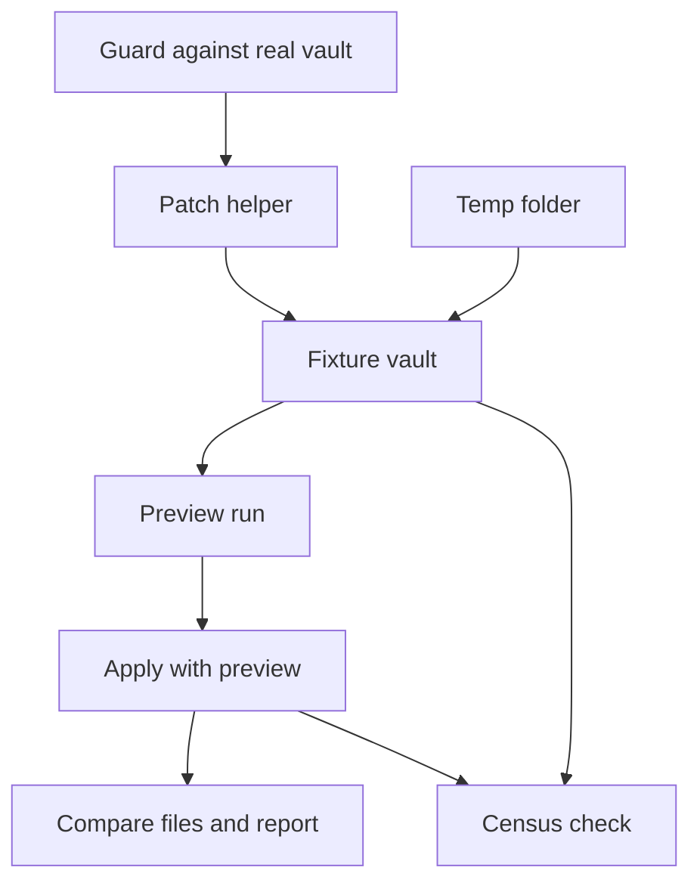

## Purpose

This file tests "Run 4" of the vault frontmatter backfill tool: the run that labels notes outside the ticket folders by the folder they sit in. It checks the folder table, the file classes (create, add, rewrite, left alone), which folders are in scope, the preview-then-apply gates, the report contents, and the matching check in the vault census tool. It also freezes the report the earlier runs produce, and enforces a few code standards on the two tools. Every input is a made-up byte string or a fixture vault built in a temp folder.

## Dependencies

**Depends on.**
- Standard library: `ast`, `hashlib`, `json`, `logging`, `os`, `subprocess`, `sys`, `pathlib`, `typing` {src:tests/scripts/state/test_backfill_nonticket_policy.py:19-27}.
- Outside package: `yaml` {src:tests/scripts/state/test_backfill_nonticket_policy.py:30}. The `git` program is run as a child process {src:tests/scripts/state/test_backfill_nonticket_policy.py:103-107}.
- [[minipytest]] and [minipytest](minipytest.md), imported under the name `pytest` {src:tests/scripts/state/test_backfill_nonticket_policy.py:29}.
- Code under test: [[backfill_vault_frontmatter]] and [backfill_vault_frontmatter](../../../scripts/state/backfill_vault_frontmatter.md), imported as `tool`, and [[vault_census]] and [vault_census](../../../scripts/state/vault_census.md), imported as `census` {src:tests/scripts/state/test_backfill_nonticket_policy.py:32-34}.

**Used by.** Product code: none (searched `git grep` for `test_backfill_nonticket_policy` outside `docs/` on 2026-11-20; the only hit is the file itself and the name list in the bridge). Tests and runners: the bridge lists it {src:tests/scripts/state/test_pytest_bridge.py:20}, and [[test_pytest_bridge]] and [test_pytest_bridge](test_pytest_bridge.md) is loaded by [[run]] and [run](run.md) {src:tests/scripts/state/run.sh:6}.

## Behavior

**Shared setup.**
- An autouse fixture replaces the tool's `default_vault_root` with a function that raises, so no test can fall back to the real vault {src:tests/scripts/state/test_backfill_nonticket_policy.py:83-91}.
- The `vault` fixture makes a git repository in a temp folder, with a fixed user name and email, signing off, and `HOME`, the global git config and the git search ceiling all pointed away from the real machine {src:tests/scripts/state/test_backfill_nonticket_policy.py:94-153}.
- Helpers: `preview` runs Run 4 without writing {src:tests/scripts/state/test_backfill_nonticket_policy.py:167-169}; `apply_run4` takes a preview and applies it bound to that preview {src:tests/scripts/state/test_backfill_nonticket_policy.py:172-175}. The expected folder rows are typed here as literals, never read from the tool {src:tests/scripts/state/test_backfill_nonticket_policy.py:54-66}.

**TestFolderRows (what each case proves).**
- One note per row (`N1` to `N6`, `N10`) gets its expected `catalog_type`, `doc_role` and `indexable` (a real boolean), `indexed` is null, the report names the row as `kind`, and the class is `add` {src:tests/scripts/state/test_backfill_nonticket_policy.py:189-201}. The tool's folder table has those seven rows {src:scripts/state/backfill_vault_frontmatter.py:657-668}.
- The literal ids are seven distinct values, all start with `N`, and none equals a ticket id `K1` to `K14` {src:tests/scripts/state/test_backfill_nonticket_policy.py:203-207}.
- A duplicate id, or an id without the `N` prefix, is refused by the load check with `ValueError` {src:tests/scripts/state/test_backfill_nonticket_policy.py:209-216}, matching the check {src:scripts/state/backfill_vault_frontmatter.py:677-684}.
- A path inside a scope A folder but under no row is skipped as `NO_KIND_ROW` and nothing is written {src:tests/scripts/state/test_backfill_nonticket_policy.py:218-227} {src:scripts/state/backfill_vault_frontmatter.py:1564-1565}.
- The note's `doc_type` is ignored: nine values (including an empty one) all leave the folder's triple {src:tests/scripts/state/test_backfill_nonticket_policy.py:229-238}.

**TestRun4Classes.**
- A note with no frontmatter gets a four-line block above all original bytes, class `create` {src:tests/scripts/state/test_backfill_nonticket_policy.py:242-252}.
- A note with only a `tags` line gets the four lines just above the closing delimiter {src:tests/scripts/state/test_backfill_nonticket_policy.py:254-263}. The tool plans that case as class `add` {src:scripts/state/backfill_vault_frontmatter.py:1321-1322}.
- The exact placeholder note (`unknown`, `unknown`, false) is rewritten line for line, counted as `changed` and not `written` {src:tests/scripts/state/test_backfill_nonticket_policy.py:265-279} {src:scripts/state/backfill_vault_frontmatter.py:1323-1324}.
- CRLF notes stay CRLF for both `add` and `create` {src:tests/scripts/state/test_backfill_nonticket_policy.py:281-291}.
- A note that already has all four fields is left alone; one whose values differ from the row is listed in `complete_differs` but not changed {src:tests/scripts/state/test_backfill_nonticket_policy.py:293-307} {src:scripts/state/backfill_vault_frontmatter.py:1325}.
- Five terminal statuses, with case and padding changes, force `indexable: false` {src:tests/scripts/state/test_backfill_nonticket_policy.py:309-315} {src:scripts/state/backfill_vault_frontmatter.py:153-155}. A status such as `active | archived` that only contains a terminal word stays indexable {src:tests/scripts/state/test_backfill_nonticket_policy.py:317-323}.
- Unparseable frontmatter is skipped as `PARSE_ERROR` and the bytes stay the same {src:tests/scripts/state/test_backfill_nonticket_policy.py:325-331} {src:scripts/state/backfill_vault_frontmatter.py:1555-1558}. A file starting `---` with no closing line is skipped as `UNSAFE_TOP` {src:tests/scripts/state/test_backfill_nonticket_policy.py:333-339} {src:scripts/state/backfill_vault_frontmatter.py:866-873}.

**TestRun4Scope.**
- Nine notes outside scope A (landing, tickets, memory, `sql`, conversations, workflows, trajectories, a top-level file) are never targets and stay byte identical {src:tests/scripts/state/test_backfill_nonticket_policy.py:70-80} {src:tests/scripts/state/test_backfill_nonticket_policy.py:343-349} {src:scripts/state/backfill_vault_frontmatter.py:690-697}.
- The walk for Run 4 skips only the memory folder and root-level dot folders {src:tests/scripts/state/test_backfill_nonticket_policy.py:351-360} {src:scripts/state/backfill_vault_frontmatter.py:1096-1099}. The default walk skips memory too, and every run number gets the same exclusion tuple {src:tests/scripts/state/test_backfill_nonticket_policy.py:362-370} {src:scripts/state/backfill_vault_frontmatter.py:1761-1763}.
- A decision note is labelled and a memory note is not; the report lists `memory/` under `exclusions` {src:tests/scripts/state/test_backfill_nonticket_policy.py:372-381}. A ticket note is not a Run 4 target even with no label {src:tests/scripts/state/test_backfill_nonticket_policy.py:383-387}.

**TestRun4Policy.** A mixed fixture holds seven notes (add, create, rewrite, complete, unparseable, no row, outside scope) {src:tests/scripts/state/test_backfill_nonticket_policy.py:391-406}.
- Preview writes nothing: git status, file hashes and modification times are unchanged {src:tests/scripts/state/test_backfill_nonticket_policy.py:408-421}.
- The apply report equals the preview report on counts, classes, kinds, skip reasons, writes and skips {src:tests/scripts/state/test_backfill_nonticket_policy.py:423-428}.
- After apply, a second preview plans nothing, also after committing {src:tests/scripts/state/test_backfill_nonticket_policy.py:430-438}.
- The counts add up (written 2, changed 1, skipped 2, already complete 1) {src:tests/scripts/state/test_backfill_nonticket_policy.py:440-447}, and `by_kind` shows the `N` row of each write {src:tests/scripts/state/test_backfill_nonticket_policy.py:449-454}.

**TestRun4Gates.**
- Apply on a dirty tree is refused with the tool's dirty-tree message and the file is unchanged {src:tests/scripts/state/test_backfill_nonticket_policy.py:458-466} {src:scripts/state/backfill_vault_frontmatter.py:1812-1814}.
- Apply with no approved report, or with a report from another run, is refused {src:tests/scripts/state/test_backfill_nonticket_policy.py:468-481} {src:scripts/state/backfill_vault_frontmatter.py:1751-1754}.
- A write the preview did not show (a file added after the preview) is refused {src:tests/scripts/state/test_backfill_nonticket_policy.py:483-490} {src:scripts/state/backfill_vault_frontmatter.py:1755-1758}.
- An uncommitted or untracked note is skipped, not written {src:tests/scripts/state/test_backfill_nonticket_policy.py:492-496} {src:scripts/state/backfill_vault_frontmatter.py:1566-1568}.
- The command line takes `--run 4`; apply without `--approved-report` exits 2 and writes nothing, and with the saved preview it exits 0 {src:tests/scripts/state/test_backfill_nonticket_policy.py:498-509} {src:scripts/state/backfill_vault_frontmatter.py:2069-2070}. `--approved-report` without `--apply` exits 2 {src:tests/scripts/state/test_backfill_nonticket_policy.py:511-516} {src:scripts/state/backfill_vault_frontmatter.py:2067-2068}.

**TestRun4Report.**
- A made-up marker string placed in titles, bodies, doc types and broken frontmatter never appears in the report, stdout, stderr or log records over a preview and an apply {src:tests/scripts/state/test_backfill_nonticket_policy.py:520-544}.
- Each report entry holds only `path`, `class`, `kind`, `added`, `changes`, and the report is valid JSON {src:tests/scripts/state/test_backfill_nonticket_policy.py:546-553}.
- A note whose only distinctive content is the marker in a frontmatter value is still labelled by folder (row `N1`), and the marker stays in the file {src:tests/scripts/state/test_backfill_nonticket_policy.py:555-562}.

**TestRun4Census.** These check the vault census tool against the same rows.
- The census copy of the folder table returns the same triple for each literal row {src:tests/scripts/state/test_backfill_nonticket_policy.py:566-568} {src:scripts/state/vault_census.py:458-469}. It returns none outside scope A and for a path under no row {src:tests/scripts/state/test_backfill_nonticket_policy.py:570-573}. A terminal status gives `indexable` false {src:tests/scripts/state/test_backfill_nonticket_policy.py:575-577}.
- `check_writes` accepts a clean Run 4 apply: 3 checked, no mismatch, none missing {src:tests/scripts/state/test_backfill_nonticket_policy.py:579-593} {src:scripts/state/vault_census.py:755-788}.
- Before apply it counts the notes still missing a field and reports `FIELD_MISSING` and `NO_FRONTMATTER` {src:tests/scripts/state/test_backfill_nonticket_policy.py:595-608} {src:scripts/state/vault_census.py:737-752}.
- A note edited so its role differs from the folder row gives `TRIPLE_DIFFERS` with the path {src:tests/scripts/state/test_backfill_nonticket_policy.py:610-620} {src:scripts/state/vault_census.py:698-714}.
- A report without the `run` key is not treated as Run 4, so a non-ticket path gives `NO_KIND_ROW` and no missing-field count {src:tests/scripts/state/test_backfill_nonticket_policy.py:622-631} {src:scripts/state/vault_census.py:674-677}.
- The census default walk skips memory, and its Run 4 list gives the same answer {src:tests/scripts/state/test_backfill_nonticket_policy.py:633-637} {src:scripts/state/vault_census.py:146}.

**TestRun4Regression.** A fixed set of notes {src:tests/scripts/state/test_backfill_nonticket_policy.py:640-653} is run through `main` with no `--run` and with runs 1, 2 and 3. The printed JSON must equal a frozen literal for each mode {src:tests/scripts/state/test_backfill_nonticket_policy.py:656-784} {src:tests/scripts/state/test_backfill_nonticket_policy.py:787-798}. This proves Run 4 did not change the older report shapes.

**TestRun4Standards.**
- Both tools import only an allowlist of modules and none of the forbidden network or model packages {src:tests/scripts/state/test_backfill_nonticket_policy.py:802-820}.
- Every function in both tools has type hints and is at most 40 lines {src:tests/scripts/state/test_backfill_nonticket_policy.py:822-832}.
- This test file's own first 25 lines carry the six header labels {src:tests/scripts/state/test_backfill_nonticket_policy.py:834-838}.

## Diagram

The autouse guard and the `vault` fixture share one patch helper {src:tests/scripts/state/test_backfill_nonticket_policy.py:88-91} {src:tests/scripts/state/test_backfill_nonticket_policy.py:140-153}.

## Notes

- Code and description: the header says the tests cover "the folder rows N1 to N6 and N10" {src:tests/scripts/state/test_backfill_nonticket_policy.py:3}. True; the table has those seven {src:scripts/state/backfill_vault_frontmatter.py:657-668}.
- Code and description, in the tool: the walk docstring says "the default is the standard list, and Run 4 passes its own" {src:scripts/state/backfill_vault_frontmatter.py:1111}. In code, the Run 4 list is the same tuple as the default {src:scripts/state/backfill_vault_frontmatter.py:225}, and a test checks that they are equal {src:tests/scripts/state/test_backfill_nonticket_policy.py:362-370}.
- A test whose name is off: `test_the_new_test_file_has_a_header` checks this file, not a new one {src:tests/scripts/state/test_backfill_nonticket_policy.py:834-838}.
- Frozen data with no commit id: the regression literal says it came from "the tool at the commit before the earlier change" {src:tests/scripts/state/test_backfill_nonticket_policy.py:655}. No commit is named, so the source cannot be checked, and the literal breaks on any report change in runs 1 to 3.
- Tests that depend on the environment: they need the `git` program and PyYAML {src:tests/scripts/state/test_backfill_nonticket_policy.py:30} {src:tests/scripts/state/test_backfill_nonticket_policy.py:103}. The standards test uses `end_lineno`, which needs Python 3.8 or later {src:tests/scripts/state/test_backfill_nonticket_policy.py:831}. No machine path is hard-coded; folders come from `tmp_path` {src:tests/scripts/state/test_backfill_nonticket_policy.py:141-143}.
- Fragile: the standards test applies the 40-line and type-hint limits to the whole of both tools {src:tests/scripts/state/test_backfill_nonticket_policy.py:822-832}, so any longer function added to either tool fails this test.
- Inputs reaching a file path, command or network address without a check: `Vault.write` joins the given relative path onto the vault root with no check {src:tests/scripts/state/test_backfill_nonticket_policy.py:119-122}. `Vault.git` passes its arguments to `git` as a list, with no shell {src:tests/scripts/state/test_backfill_nonticket_policy.py:103-107}. All values come from test literals. In the tool under test, `--report-path` is written with a plain `write_text` after a parent-folder check {src:scripts/state/backfill_vault_frontmatter.py:2086-2093}. No network address is built.
- Writes to shared files: the test writes only inside a temp folder. The tool's note write is atomic through a temp file and `os.replace`, with a re-read guard against a changed file {src:scripts/state/backfill_vault_frontmatter.py:1587-1618}. The report file write is not atomic, and nothing stops two writers at once {src:scripts/state/backfill_vault_frontmatter.py:2090-2097}.
