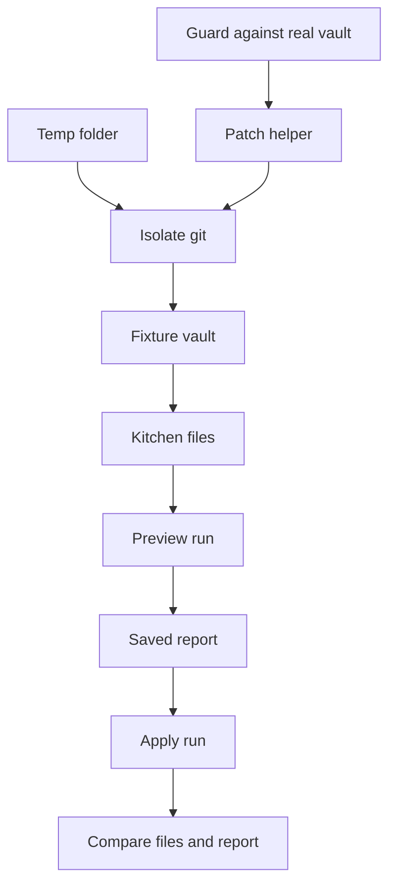

## Purpose

This is the largest test file for the vault frontmatter backfill tool. It tests the ticket side of the tool: the table that picks a role by file name, the rule for terminal statuses, the placeholder test, how a new frontmatter block is made and checked, how single lines are replaced and checked, and then the whole run planner (runs 1 to 3), the approved-report gate, the clean-tree gate, the report, and the command line. It also holds code-standard checks on the tool and on itself, and a frozen copy of the older report shape.

## Dependencies

**Depends on.**
- Standard library: `ast`, `difflib`, `hashlib`, `json`, `logging`, `os`, `subprocess`, `sys`, `types`, `pathlib`, `typing` {src:tests/scripts/state/test_backfill_ticket_policy.py:29-39}.
- Outside package: `yaml` {src:tests/scripts/state/test_backfill_ticket_policy.py:42}. The `git` program is run as a child process {src:tests/scripts/state/test_backfill_ticket_policy.py:1427-1431}.
- [[minipytest]] and [minipytest](minipytest.md), imported as `pytest` {src:tests/scripts/state/test_backfill_ticket_policy.py:41}.
- Code under test: [[backfill_vault_frontmatter]] and [backfill_vault_frontmatter](../../../scripts/state/backfill_vault_frontmatter.md), imported as `tool` {src:tests/scripts/state/test_backfill_ticket_policy.py:44-45}. The test also reads the tool's source text from disk {src:tests/scripts/state/test_backfill_ticket_policy.py:47} {src:tests/scripts/state/test_backfill_ticket_policy.py:379}.

**Used by.** Product code: none (searched `git grep` for `test_backfill_ticket_policy` outside `docs/` on 2026-11-20; only this file and the bridge name it). Tests and runners: the bridge lists it {src:tests/scripts/state/test_pytest_bridge.py:19}; [[test_pytest_bridge]] and [test_pytest_bridge](test_pytest_bridge.md) is loaded by [[run]] and [run](run.md) {src:tests/scripts/state/run.sh:6}.

## Behavior

**Shared setup (second half of the file).** An autouse fixture replaces the tool's `default_vault_root` with a function that raises {src:tests/scripts/state/test_backfill_ticket_policy.py:51-59}. The `rv` fixture makes an isolated git repository in a temp folder with a first commit that holds the ignore rules `ignored/` and `*.ignored.md` {src:tests/scripts/state/test_backfill_ticket_policy.py:1339} {src:tests/scripts/state/test_backfill_ticket_policy.py:1434-1440} {src:tests/scripts/state/test_backfill_ticket_policy.py:1472-1478}. Git is isolated from the machine: no global or system config, `HOME` and the XDG folder moved, and a search ceiling {src:tests/scripts/state/test_backfill_ticket_policy.py:1401-1415}. Expected values are typed as literals, never read from the tool {src:tests/scripts/state/test_backfill_ticket_policy.py:69-102} {src:tests/scripts/state/test_backfill_ticket_policy.py:1504-1524}.

**TestKindRows** (the name table; the tool's table is {src:scripts/state/backfill_vault_frontmatter.py:591-608}).
- The literal table lists 14 ids in order {src:tests/scripts/state/test_backfill_ticket_policy.py:190-192}.
- Every example name gets its row in four spellings: plain, with the ticket folder prefix, and both in upper case {src:tests/scripts/state/test_backfill_ticket_policy.py:194-203}. The function being tested is `kind_row_for` {src:scripts/state/backfill_vault_frontmatter.py:792-807}.
- The state row `K2` takes only the exact `T-900-state.md` directly under the ticket folder {src:tests/scripts/state/test_backfill_ticket_policy.py:205-212}. The ticket main file (`T-900.md`, any case) is `K10`, and another ticket's name is not {src:tests/scripts/state/test_backfill_ticket_policy.py:214-222}.
- Sixteen odd names get no row, and thirteen paths outside the table get none (`02-tickets/loose.md`, a doubled slash, `..`, a non-markdown extension, and others); `None` and `7` as a path give no row without raising {src:tests/scripts/state/test_backfill_ticket_policy.py:105-136} {src:tests/scripts/state/test_backfill_ticket_policy.py:224-234}.
- The folder prefix needs its hyphen and is removed once {src:tests/scripts/state/test_backfill_ticket_policy.py:236-240}. A star pattern never reuses one character for both ends {src:tests/scripts/state/test_backfill_ticket_policy.py:242-247}. The first matching row wins {src:tests/scripts/state/test_backfill_ticket_policy.py:249-252}.
- The exact name `session-notes.md` is `K10` (a ticket summary), while dated or longer session-notes names stay `K9`; a name that only contains it gets no row {src:tests/scripts/state/test_backfill_ticket_policy.py:254-271}. The tool excludes that name from `K9` and lists it under `K10` {src:scripts/state/backfill_vault_frontmatter.py:600-601}.
- A name claimed by two rows goes to the earlier one {src:tests/scripts/state/test_backfill_ticket_policy.py:273-287}.
- Anything under a folder named `archive` or `history` (any case, any depth) is `K1`: role by file name, never indexable {src:tests/scripts/state/test_backfill_ticket_policy.py:289-318} {src:scripts/state/backfill_vault_frontmatter.py:803-804}. Only an exact folder name makes `K1`, and archive does not change other rows {src:tests/scripts/state/test_backfill_ticket_policy.py:320-328}.
- `row_values` follows the row and forces `indexable` false for a terminal status; a row that is already not indexable stays false; an odd mapping does not raise {src:tests/scripts/state/test_backfill_ticket_policy.py:330-346} {src:scripts/state/backfill_vault_frontmatter.py:824-830}.

**TestKindRowsRoleByName.** `role_by_name` gives each row's role for plain and prefixed names, treats any name ending in `-state.md` as state (even `-STATE`), gives `reference` for unknown names and paths outside a ticket folder, and survives `None` {src:tests/scripts/state/test_backfill_ticket_policy.py:349-374} {src:scripts/state/backfill_vault_frontmatter.py:776-789}.

**TestKindRowsLoadCheck.**
- The table check runs when the module loads: the test changes `KindRow("K2", ` to `KindRow("K7", ` in the tool's own source, runs that text with `exec`, and expects a `ValueError` with `KIND_ROWS_INVALID` {src:tests/scripts/state/test_backfill_ticket_policy.py:378-385} {src:scripts/state/backfill_vault_frontmatter.py:628}.
- Ordered ids with sound patterns pass; repeated ids, out-of-order ids, a non-`K` id, an upper-case pattern and a pattern with two stars each raise {src:tests/scripts/state/test_backfill_ticket_policy.py:394-410} {src:scripts/state/backfill_vault_frontmatter.py:611-625}. A non-lowercase exclusion raises; a lowercase one passes {src:tests/scripts/state/test_backfill_ticket_policy.py:412-423}.

**TestTerminalStatus and TestTerminalStatusPlaceholder.**
- Each of five terminal words flips, in any case and with padding {src:tests/scripts/state/test_backfill_ticket_policy.py:432-439} {src:scripts/state/backfill_vault_frontmatter.py:153-155} {src:scripts/state/backfill_vault_frontmatter.py:810-821}. Eleven other strings (such as `active | archived`, `archived.`, `not archived`) and non-string values are not terminal {src:tests/scripts/state/test_backfill_ticket_policy.py:441-468}. A parsed `status:` line is read by the same rule {src:tests/scripts/state/test_backfill_ticket_policy.py:470-474}.
- The placeholder test accepts only `unknown`, `unknown`, boolean false (extra keys allowed) {src:tests/scripts/state/test_backfill_ticket_policy.py:486-489} {src:scripts/state/backfill_vault_frontmatter.py:833-844}. Twelve single changes, a missing triple field, a hand-set triple, and odd values are not a placeholder {src:tests/scripts/state/test_backfill_ticket_policy.py:491-524}. A quoted `"false"` parses as a string and is not a placeholder {src:tests/scripts/state/test_backfill_ticket_policy.py:526-530}.

**TestCreateBlockEol, TestCreateBlock, TestCreateBlockUnsafeTop, TestCreateBlockVerify** (making a new block).
- The first line ending decides: CRLF only when the first LF is preceded by CR; no ending, a leading blank line, or a lone CR gives LF {src:tests/scripts/state/test_backfill_ticket_policy.py:534-551} {src:scripts/state/backfill_vault_frontmatter.py:847-852}.
- `render_block` writes the four fields in order between delimiters, using the given ending on every line; `indexed` is null; `create_block` puts the block before every original byte {src:tests/scripts/state/test_backfill_ticket_policy.py:571-586} {src:scripts/state/backfill_vault_frontmatter.py:855-863}. Nine byte strings (CRLF, mixed, no trailing newline, invalid UTF-8, a NUL byte) pass the self check {src:tests/scripts/state/test_backfill_ticket_policy.py:588-608}.
- Ten unsafe tops (empty, three BOM kinds, unclosed frontmatter, bare `---`, `----`, existing frontmatter) are refused by `is_safe_top` and by the self check; six ordinary tops are safe {src:tests/scripts/state/test_backfill_ticket_policy.py:624-654} {src:scripts/state/backfill_vault_frontmatter.py:866-873}.
- `verify_create` refuses dropped or extra bytes, a changed original byte, a same-length edit inside the block, a block in the wrong line ending, a missing or doubled closing line, a missing block, a block that does not parse to the four exact fields in order with exact types, a value that would inject a line, and values that do not match the block {src:tests/scripts/state/test_backfill_ticket_policy.py:665-741} {src:scripts/state/backfill_vault_frontmatter.py:903-919}. Odd bytes never raise {src:tests/scripts/state/test_backfill_ticket_policy.py:743-746}.

**TestReplaceLines and TestReplaceLinesVerify** (changing single lines).
- `field_line_span` returns the offsets of the one column-zero line (with its CR kept), and gives none when the field is absent, repeated, nested, quoted, a longer name, or unusable {src:tests/scripts/state/test_backfill_ticket_policy.py:771-819} {src:scripts/state/backfill_vault_frontmatter.py:950-965}.
- A flip replaces one line and leaves every other byte; a rewrite replaces exactly three lines (two when the row stays not indexable); edit order does not matter; CRLF stays CRLF {src:tests/scripts/state/test_backfill_ticket_policy.py:821-859}.
- `replace_field_lines` refuses ten spellings of the old line (`True`, quotes, comment, extra spaces, `yes`, `false` and others), a YAML alias of the old value, two matching lines, a missing line, a mixed line ending, no edits, two edits on one line, an edit that changes nothing, a new value with a line break, malformed edits, and a span that describes other bytes; it never changes the input bytes {src:tests/scripts/state/test_backfill_ticket_policy.py:861-965} {src:scripts/state/backfill_vault_frontmatter.py:974-1029}.
- `verify_replace` accepts a correct flip, CRLF flip and rewrite, and refuses tampering with another line, a same-length move, no change, a lost line ending, a replaced line that differs from the plan (`False` for `false`), expected values wrong by type, expected keys not equal to the edited fields, and a mapping that differs from the file {src:tests/scripts/state/test_backfill_ticket_policy.py:979-1054} {src:scripts/state/backfill_vault_frontmatter.py:1048-1073}. A comparison that raises counts as failed, logs only the exception class, and never the marker text {src:tests/scripts/state/test_backfill_ticket_policy.py:1091-1104} {src:scripts/state/backfill_vault_frontmatter.py:889-891}.

**TestLocalOnly\* (standards).**
- The tool imports only an allowlist of modules (any import anywhere in the file, including inside functions and `__import__`) {src:tests/scripts/state/test_backfill_ticket_policy.py:1107-1144} {src:tests/scripts/state/test_backfill_ticket_policy.py:1212-1230}.
- A fresh interpreter that imports the tool loads none of the forbidden network or model modules; a probe with a preloaded `socket` proves the probe can see one {src:tests/scripts/state/test_backfill_ticket_policy.py:1233-1269}.
- The tool and this test file itself must have typed functions of at most 40 lines, no `print`, the six header labels in the first 40 lines, and no unfinished-work marker; the marker word is built by joining two strings so the file does not match itself {src:tests/scripts/state/test_backfill_ticket_policy.py:1118-1124} {src:tests/scripts/state/test_backfill_ticket_policy.py:1272-1302}.
- Neither file uses a `match` statement or a `|` union in an annotation (a rule kept from when the minimum was 3.9; the minimum is now 3.12); the match check is skipped below Python 3.10 {src:tests/scripts/state/test_backfill_ticket_policy.py:1305-1326}, a condition that is always false on 3.12, so the check always runs.

**TestAC01 to TestAC03 (kind rows end to end).** A "kitchen" vault holds one file per kind row `K1` to `K13` plus an unmatched file {src:tests/scripts/state/test_backfill_ticket_policy.py:1367-1382}. With bare files, run 2 writes exactly the expected bytes for each, leaves the unmatched file alone, and reports one `NO_KIND_ROW` and 13 written {src:tests/scripts/state/test_backfill_ticket_policy.py:1654-1662}. For each run the written triple equals the literal and `indexed` is null, never a string {src:tests/scripts/state/test_backfill_ticket_policy.py:1668-1683}. In diff terms: an add inserts four lines and deletes none, a create inserts six and deletes none, a flip replaces one line, and a rewrite replaces three (two when `indexable` stays false) {src:tests/scripts/state/test_backfill_ticket_policy.py:1687-1726}. A planner given a replacer that also changes another line skips the file as `VERIFY_FAILED` {src:tests/scripts/state/test_backfill_ticket_policy.py:1740-1756}. The tool's planner order is symlink, unreadable, parse, candidacy, row, git check, mixed check, then edit and self check {src:scripts/state/backfill_vault_frontmatter.py:1539-1574}.

**TestPlanRun1 (add and flip).**
- An add plans the four lines for every row, keeps present fields, inserts only missing ones, and never touches a present `indexed` {src:tests/scripts/state/test_backfill_ticket_policy.py:1760-1792}.
- A terminal-status file without `indexable` gets false; one that already reads false and complete changes nothing {src:tests/scripts/state/test_backfill_ticket_policy.py:1794-1817}.
- A present field that conflicts with the row skips the file with `CONFLICT_DOC_ROLE`, `CONFLICT_INDEXABLE` or `CONFLICT_CATALOG_TYPE` {src:tests/scripts/state/test_backfill_ticket_policy.py:1819-1833}.
- A terminal file with `indexable: true` flips one line; a flip needs no kind row, even outside tickets, but the conversation and chat-thread folders never flip {src:tests/scripts/state/test_backfill_ticket_policy.py:1835-1873} {src:scripts/state/backfill_vault_frontmatter.py:1305-1307} {src:scripts/state/backfill_vault_frontmatter.py:1353-1355}.
- A file needing both an add and a flip is skipped as `MIXED_EDIT`; a flip line in eight unaccepted forms is skipped as `UNEXPECTED_LINE_FORM`; CRLF files stay CRLF {src:tests/scripts/state/test_backfill_ticket_policy.py:1875-1917}.
- An add with no kind row is skipped as `NO_KIND_ROW`; an unparseable ticket file is skipped as `PARSE_ERROR` while one outside tickets is not a target {src:tests/scripts/state/test_backfill_ticket_policy.py:1919-1935} {src:scripts/state/backfill_vault_frontmatter.py:1532-1536}.
- Run 1 leaves bare, placeholder and complete files alone {src:tests/scripts/state/test_backfill_ticket_policy.py:1937-1945}. The report counts 13 written, 10 resulting true and 3 false {src:tests/scripts/state/test_backfill_ticket_policy.py:1947-1954}. `complete_differs` lists only hand-set files that no run touches {src:tests/scripts/state/test_backfill_ticket_policy.py:1956-1970}.

**TestPlanRun2 (create).**
- A create plans a block for every row, keeps every original byte, and uses the first line ending across eight byte shapes {src:tests/scripts/state/test_backfill_ticket_policy.py:1996-2017}.
- Eight unsafe tops are skipped as `UNSAFE_TOP`, stay byte identical, and are not written on apply {src:tests/scripts/state/test_backfill_ticket_policy.py:1983-1992} {src:tests/scripts/state/test_backfill_ticket_policy.py:2019-2039}.
- Files with frontmatter are not created over; bare files outside ticket folders are not targets; a bare file with no row is skipped {src:tests/scripts/state/test_backfill_ticket_policy.py:2041-2074}. An archive state file is `K1` with role `state` and not indexable {src:tests/scripts/state/test_backfill_ticket_policy.py:2084-2093}.

**TestPlanRun3 (rewrite).**
- The exact placeholder is rewritten for every row, with the labelled `doc_type`; other variants (six hand-set shapes) are left as already complete; six odd line forms are skipped as `UNEXPECTED_LINE_FORM` and stay left {src:tests/scripts/state/test_backfill_ticket_policy.py:2116-2148}.
- A placeholder with no row is skipped with its label; the label is the report-safe `doc_type` (`<non-string>` for a number or list, `<unprintable>` for text with a space) {src:tests/scripts/state/test_backfill_ticket_policy.py:2150-2172}.
- Dispositions count `resolved` and `left` per label in run 3 only {src:tests/scripts/state/test_backfill_ticket_policy.py:2174-2196}. A terminal status makes a rewrite keep `indexable` false; CRLF is kept and `indexed` is left alone {src:tests/scripts/state/test_backfill_ticket_policy.py:2198-2220}. A placeholder with no `indexed` line is not a run 3 target and is a `CONFLICT_CATALOG_TYPE` skip in run 1 {src:tests/scripts/state/test_backfill_ticket_policy.py:2222-2228}.

**Approved-report tests** (`TestApprovedReportUnapprovedEntries`, `TestApprovedReportLoad`, `TestApprovedReport`).
- `unapproved_entries` returns planned writes whose path, class, kind, added fields or changes differ from the approved entry; an integer 1 does not stand in for true; approved entries that were not planned are ignored; a malformed report approves nothing and never raises {src:tests/scripts/state/test_backfill_ticket_policy.py:2270-2317} {src:scripts/state/backfill_vault_frontmatter.py:1726-1744}.
- `load_approved_report` accepts a preview for the run; a missing file or folder, non-JSON, wrong shapes, or duplicate paths are `APPROVED_REPORT_INVALID`; an apply-mode report or another run is `APPROVED_REPORT_MISMATCH`; the code carries no file text {src:tests/scripts/state/test_backfill_ticket_policy.py:2321-2360} {src:scripts/state/backfill_vault_frontmatter.py:1693-1707}.
- Through the command line: an extra planned entry, any changed entry, or a file edited after the preview exits 2 with `NOT_APPROVED`, prints nothing and leaves every file unchanged {src:tests/scripts/state/test_backfill_ticket_policy.py:2372-2425}. A subset of the approved entries passes and writes only those {src:tests/scripts/state/test_backfill_ticket_policy.py:2456-2473}. The approved check comes before the first write {src:tests/scripts/state/test_backfill_ticket_policy.py:2501-2510} {src:scripts/state/backfill_vault_frontmatter.py:1817-1819}.

**TestTreeClean.** A clean tree is `(True, 0)`; untracked files count one each; modified, staged and deleted files count one; ignored files do not count {src:tests/scripts/state/test_backfill_ticket_policy.py:2514-2545} {src:scripts/state/backfill_vault_frontmatter.py:1662-1669}. A folder that is not a repository raises `GIT_NONZERO_EXIT` {src:tests/scripts/state/test_backfill_ticket_policy.py:2547-2555}. Preview on a dirty tree reports it and still plans {src:tests/scripts/state/test_backfill_ticket_policy.py:2557-2564}. Apply on a dirty tree exits 2 with `DIRTY_TREE` before any file is read, including after a partial apply {src:tests/scripts/state/test_backfill_ticket_policy.py:2569-2597} {src:scripts/state/backfill_vault_frontmatter.py:1810-1814}.

**TestRunWiring.** Preview never reaches `apply_edit` {src:tests/scripts/state/test_backfill_ticket_policy.py:2619-2628}. Apply calls `_apply_outcome` once per planned file {src:tests/scripts/state/test_backfill_ticket_policy.py:2630-2646}. An unexpected planning error skips the file as `VERIFY_FAILED` and logs only the class name {src:tests/scripts/state/test_backfill_ticket_policy.py:2654-2667} {src:scripts/state/backfill_vault_frontmatter.py:1572-1574}. A `KeyboardInterrupt` while planning writes nothing; one while writing leaves whole files and a rerun finishes {src:tests/scripts/state/test_backfill_ticket_policy.py:2669-2715}. A file changed after planning keeps its newer bytes with `CHANGED_DURING_RUN` {src:tests/scripts/state/test_backfill_ticket_policy.py:2717-2736} {src:scripts/state/backfill_vault_frontmatter.py:1600-1601}. Git is called only with `status`, `ls-files` and `diff`, and every `status` call has `--no-optional-locks` first {src:tests/scripts/state/test_backfill_ticket_policy.py:2738-2754}.

**TestRunCli.** Five refused flag combinations exit 2 before any git call {src:tests/scripts/state/test_backfill_ticket_policy.py:2765-2787} {src:scripts/state/backfill_vault_frontmatter.py:2061-2070}. Bad `--run` values and abbreviated flags exit 2 from the parser {src:tests/scripts/state/test_backfill_ticket_policy.py:2789-2796} {src:scripts/state/backfill_vault_frontmatter.py:2016}. A preview prints the report and saves identical text {src:tests/scripts/state/test_backfill_ticket_policy.py:2805-2814}. The log summary carries counts and no path {src:tests/scripts/state/test_backfill_ticket_policy.py:2825-2834}. A bad report path and a non-repository both exit 2 {src:tests/scripts/state/test_backfill_ticket_policy.py:2836-2855}. A read-only target among ten exits 3 with `WRITE_FAILED`, leaves no temp file, and after a commit and a permission fix a rerun writes the last one {src:tests/scripts/state/test_backfill_ticket_policy.py:2857-2879}.

**TestReportContract.** The report has exactly the contract keys, entries are sorted, `changes` are `[field, old, new]` lists, `not_labeled` and `exclusions` appear in every run, an empty vault gives all keys with zero counts, and the report is plain JSON {src:tests/scripts/state/test_backfill_ticket_policy.py:2902-2984}. The counts match a mixed fixture (13 written, 3 changed, 6 skipped, 2 already complete) and reconcile {src:tests/scripts/state/test_backfill_ticket_policy.py:2911-2937}.

**TestAC04 to TestAC08.**
- Ignored, symlinked, unparseable and no-row files stay byte identical across all three runs; each gets its own closed skip code; hand-set files and the conversation, chat-thread and landing folders are never listed as writes; edited, staged and untracked candidates are skipped as `UNCOMMITTED` or `UNTRACKED` {src:tests/scripts/state/test_backfill_ticket_policy.py:3041-3096}.
- Every terminal spelling flips; the five words flip on their own; thirteen non-terminal values never flip; a missing status never flips {src:tests/scripts/state/test_backfill_ticket_policy.py:3099-3154}. After run 1 no terminal file keeps `indexable: true` {src:tests/scripts/state/test_backfill_ticket_policy.py:3156-3172}.
- Only the exact placeholder is rewritten; a placeholder with no row is counted as left; after run 3 no placeholder with a row remains {src:tests/scripts/state/test_backfill_ticket_policy.py:3182-3210}.
- Preview matches apply, a second run is empty, hand edits survive, and the three runs touch disjoint files {src:tests/scripts/state/test_backfill_ticket_policy.py:3227-3277}.
- A marker string in every non-classifying value never reaches stdout, stderr, the saved report or any log record, counts reconcile, and skip reasons and flip statuses come from closed lists {src:tests/scripts/state/test_backfill_ticket_policy.py:3329-3362}. Each row's apply-report entry has the right triple and a null `indexed` {src:tests/scripts/state/test_backfill_ticket_policy.py:3364-3373}.

**TestS257ModeUnchanged.** With no `--run`, the preview and apply reports equal a frozen literal, apply needs no clean tree, the report has none of the run keys, none of the run-mode functions are called, ticket files the older run never touches stay unlabeled, `_check_preconditions` still takes two arguments, and the exit codes are 0, 2 and 3 {src:tests/scripts/state/test_backfill_ticket_policy.py:3376-3489} {src:scripts/state/backfill_vault_frontmatter.py:132-134}.

## Diagram

The fixture chain: guard and `rv` share one patch helper, git isolation runs before the first commit {src:tests/scripts/state/test_backfill_ticket_policy.py:56-59} {src:tests/scripts/state/test_backfill_ticket_policy.py:1472-1478}.

## Notes

- Code and description disagree: the header says the file tests "the 14 kind rows" {src:tests/scripts/state/test_backfill_ticket_policy.py:2}. The tool holds 13 rows; the comment says `K14` is not a row {src:scripts/state/backfill_vault_frontmatter.py:589-608}. The end-to-end fixtures cover `K1` to `K13` only {src:tests/scripts/state/test_backfill_ticket_policy.py:1664-1665}.
- Code and description disagree: the header `Scope` list names the classes of the file {src:tests/scripts/state/test_backfill_ticket_policy.py:14-22} but omits `TestApprovedReportUnapprovedEntries` and `TestApprovedReportLoad`, which exist {src:tests/scripts/state/test_backfill_ticket_policy.py:2269} {src:tests/scripts/state/test_backfill_ticket_policy.py:2320}.
- Tests that cannot fail from a tool change: `test_the_literal_table_has_fourteen_rows_in_order` and `test_every_kind_id_is_covered_by_one_fixture` look only at literals in this file {src:tests/scripts/state/test_backfill_ticket_policy.py:190-192} {src:tests/scripts/state/test_backfill_ticket_policy.py:1664-1665}.
- Frozen data whose source cannot be checked: the golden report says it came from "the earlier tool at commit 02e2b19" {src:tests/scripts/state/test_backfill_ticket_policy.py:3398}. That commit is not in this repository (`git cat-file -t 02e2b19` failed on 2026-11-20).
- Depends on the user and machine: `test_a_read_only_target_among_ten_writes_exits_three_and_a_rerun_finishes` relies on a `0o444` file failing to write {src:tests/scripts/state/test_backfill_ticket_policy.py:2857-2863}. The tool checks `os.access` for write {src:scripts/state/backfill_vault_frontmatter.py:1602}, which is true for the root user, and this test has no root skip (the other state test file does skip {src:tests/scripts/state/test_backfill_vault_frontmatter.py:1514-1515}). As root it would be expected to fail. Symlinks and file modes need a POSIX system {src:tests/scripts/state/test_backfill_ticket_policy.py:1455-1460}. Git must be installed {src:tests/scripts/state/test_backfill_ticket_policy.py:1427-1431}.
- Python version: the match-statement test is skipped below 3.10 {src:tests/scripts/state/test_backfill_ticket_policy.py:1323}, a skip that is always false on the 3.12 minimum; `end_lineno` needs 3.8 {src:tests/scripts/state/test_backfill_ticket_policy.py:1163}; the file still enforces the old 3.9 rule on itself (no `match`, no `|` in annotations) {src:tests/scripts/state/test_backfill_ticket_policy.py:1306-1308}, kept from when 3.9 was the minimum and stricter than 3.12 needs.
- Coverage gap: every fixture path is flat (`02-tickets/T-900/...`) {src:tests/scripts/state/test_backfill_ticket_policy.py:141-143}, although the tool also reads a prefix-folder layout {src:scripts/state/backfill_vault_frontmatter.py:420-429}. The nested layout is tested elsewhere {src:tests/scripts/state/test_state_tools.py:294}.
- Inputs reaching a file path, command or network address without a check: `RunVault.write` and `symlink` join a relative path onto the vault root with no check {src:tests/scripts/state/test_backfill_ticket_policy.py:1442-1460}; all values are test literals. `RunVault.git` passes a list to `git`, not a shell string {src:tests/scripts/state/test_backfill_ticket_policy.py:1425-1431}. The load-check test runs the tool's own source text through `exec` {src:tests/scripts/state/test_backfill_ticket_policy.py:385}. The runtime probe builds a `-c` program from the tool's folder path with `repr` {src:tests/scripts/state/test_backfill_ticket_policy.py:1250-1257}. No network address is built.
- Writes to shared files: the tests write only under temp folders. The tool's note write is atomic (temp file, `fsync`, `os.replace`) with a guard that the file still equals the planned bytes {src:scripts/state/backfill_vault_frontmatter.py:1587-1618}. Nothing stops two tool runs at once.
