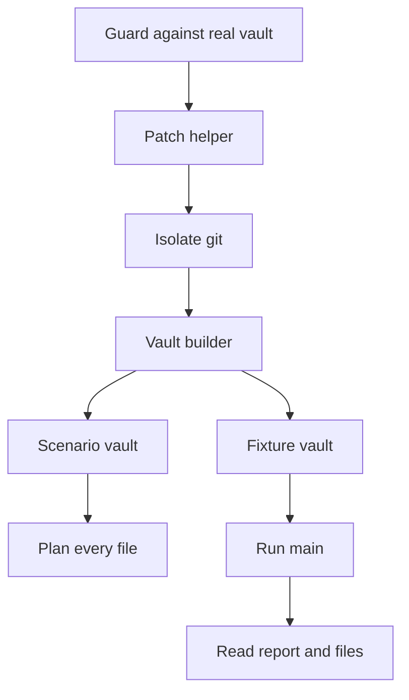

## Purpose

This is the test file for the original, `doc_type`-based part of the vault frontmatter backfill tool: the pure core (finding the frontmatter, classifying a note, inserting lines), the safety layer around it (the vault scan, the git snapshot, the planner, the atomic write), the report, the command line, and eight acceptance criteria run end to end through `main`. Every test uses a fixture vault built in a pytest-style temp folder, so none can reach the real vault.

## Dependencies

**Depends on.**
- Standard library: `dataclasses`, `hashlib`, `json`, `logging`, `os`, `re`, `shutil`, `signal`, `site`, `subprocess`, `sys`, `types`, `pathlib`, `typing` {src:tests/scripts/state/test_backfill_vault_frontmatter.py:24-37}.
- Outside package: `yaml` {src:tests/scripts/state/test_backfill_vault_frontmatter.py:40}. The `git` program is run as a child process {src:tests/scripts/state/test_backfill_vault_frontmatter.py:843-850}.
- [[minipytest]] and [minipytest](minipytest.md), imported under the name `pytest` {src:tests/scripts/state/test_backfill_vault_frontmatter.py:39}.
- Code under test: [[backfill_vault_frontmatter]] and [backfill_vault_frontmatter](../../../scripts/state/backfill_vault_frontmatter.md), imported as `tool` {src:tests/scripts/state/test_backfill_vault_frontmatter.py:42-43}. The tool file is also run as a real command by path {src:tests/scripts/state/test_backfill_vault_frontmatter.py:1836} {src:tests/scripts/state/test_backfill_vault_frontmatter.py:3568-3571}.

**Used by.** Product code: none (searched `git grep` for `test_backfill_vault_frontmatter` outside `docs/` on 2026-11-20; only this file and the bridge name it). Tests and runners: the bridge lists it {src:tests/scripts/state/test_pytest_bridge.py:18}; [[test_pytest_bridge]] and [test_pytest_bridge](test_pytest_bridge.md) is loaded by [[run]] and [run](run.md) {src:tests/scripts/state/run.sh:6}.

## Behavior

**Shared setup.**
- An autouse fixture makes the tool's `default_vault_root` raise, so no test falls back to the real vault; the real function is saved at import time for the tests that need it {src:tests/scripts/state/test_backfill_vault_frontmatter.py:45-56}.
- The 37 expected `doc_type` rows are typed here as literals {src:tests/scripts/state/test_backfill_vault_frontmatter.py:78-118}. Fourteen awkward frontmatter endings (list, comment, block scalar, quotes with links, inline dashes and others) are the fixtures for the byte tests {src:tests/scripts/state/test_backfill_vault_frontmatter.py:122-140}.
- `isolate_git` removes git environment variables that could leak, points global and system git config away, and moves `HOME` and the XDG folder {src:tests/scripts/state/test_backfill_vault_frontmatter.py:818-834}. `VaultBuilder` makes a git repository in a temp folder with a first commit holding `.gitignore` {src:tests/scripts/state/test_backfill_vault_frontmatter.py:837-892}.

**TestCoreSpan** (`split_frontmatter` and `parse_block`).
- A block is found for LF and CRLF files, for an empty block, and for a closing line at end of file; the first closing line wins {src:tests/scripts/state/test_backfill_vault_frontmatter.py:221-255} {src:scripts/state/backfill_vault_frontmatter.py:384-397}.
- Only an exact line `---` closes: seven near-misses (trailing space, four dashes, suffix, indent, tab, two dashes, inline) give no frontmatter {src:tests/scripts/state/test_backfill_vault_frontmatter.py:257-264} {src:scripts/state/backfill_vault_frontmatter.py:367-381}. Ten shapes give none at all (empty, bare delimiter, no close, leading blank, BOM, delimiter not on line one, lone carriage return) {src:tests/scripts/state/test_backfill_vault_frontmatter.py:266-287} {src:scripts/state/backfill_vault_frontmatter.py:358-364}.
- Body bytes are never decoded {src:tests/scripts/state/test_backfill_vault_frontmatter.py:289-294}.
- `parse_block` returns a mapping, an empty mapping for an empty block, and `None` for twelve failures (a list, a scalar, an unclosed flow, bad UTF-8, an impossible date, a NUL byte, a Python object tag, 5000-deep nesting) {src:tests/scripts/state/test_backfill_vault_frontmatter.py:296-327} {src:scripts/state/backfill_vault_frontmatter.py:408-417}. A failed parse logs no frontmatter text {src:tests/scripts/state/test_backfill_vault_frontmatter.py:329-336} {src:scripts/state/backfill_vault_frontmatter.py:410-411}.

**TestClassification.**
- Each of the 37 literal rows is returned by `lookup_values`, classified as row 2 for `doc_type` and row 4 for the old `type` key {src:tests/scripts/state/test_backfill_vault_frontmatter.py:343-363} {src:scripts/state/backfill_vault_frontmatter.py:432-439} {src:scripts/state/backfill_vault_frontmatter.py:457-466}. Lookup does not normalize (nine near-spellings fail), and twelve drift words such as `context` and `spec` stay unmapped {src:tests/scripts/state/test_backfill_vault_frontmatter.py:365-380}. Non-strings give none {src:tests/scripts/state/test_backfill_vault_frontmatter.py:382-388}.
- A ticket state path (`02-tickets/T-900/T-900-state.md`) is row 1 whatever the keys say, even with no frontmatter; a state-named file in the wrong place falls to other rows {src:tests/scripts/state/test_backfill_vault_frontmatter.py:390-437} {src:scripts/state/backfill_vault_frontmatter.py:420-429} {src:scripts/state/backfill_vault_frontmatter.py:453-454}.
- An unmapped or non-string `doc_type` is row 3 with the sentinel values and a safe label (`<non-string>` or `<unprintable>`; letters, digits, `.`, `-`, `_` up to 64 characters pass through) {src:tests/scripts/state/test_backfill_vault_frontmatter.py:439-473} {src:scripts/state/backfill_vault_frontmatter.py:442-448}. `doc_type` beats `type` when both exist {src:tests/scripts/state/test_backfill_vault_frontmatter.py:475-480}. Everything else is row 5, not a target {src:tests/scripts/state/test_backfill_vault_frontmatter.py:482-492} {src:scripts/state/backfill_vault_frontmatter.py:455-467}.
- `missing_additions` gives the absent fields in order, with `indexed` always null {src:tests/scripts/state/test_backfill_vault_frontmatter.py:494-533} {src:scripts/state/backfill_vault_frontmatter.py:470-487}. `find_conflict` compares type and value, in field order, and never looks at `indexed` {src:tests/scripts/state/test_backfill_vault_frontmatter.py:535-568} {src:scripts/state/backfill_vault_frontmatter.py:490-503}.

**TestInsertion.**
- `render_additions` writes one line per field with the file's line ending; lines parse back to the same typed values for all 37 rows {src:tests/scripts/state/test_backfill_vault_frontmatter.py:574-594} {src:scripts/state/backfill_vault_frontmatter.py:515-521}.
- `insert_lines` places lines directly above the closing delimiter, in LF, CRLF, empty-block and no-final-newline files; inserting nothing returns the same bytes {src:tests/scripts/state/test_backfill_vault_frontmatter.py:596-625} {src:scripts/state/backfill_vault_frontmatter.py:524-526}.
- For all 14 awkward endings in LF and CRLF, the old bytes and values survive, one of each key exists, and the self check passes {src:tests/scripts/state/test_backfill_vault_frontmatter.py:627-642}. LF files gain no CR; CRLF files stay pure CRLF; a partial file gets only its missing lines; an empty block on a state path gets all four; state files get state values whatever `type` says; a non-UTF-8 body is carried through {src:tests/scripts/state/test_backfill_vault_frontmatter.py:644-696}. Each row writes its values, and a second pass plans nothing {src:tests/scripts/state/test_backfill_vault_frontmatter.py:698-708}.
- `verify_edit` accepts a correct edit and rejects a changed prefix or suffix, different inserted bytes, a prefix change that parses the same (a comment edit), inserted bytes that parse the same (`True` for `true`), an unedited file, a dropped suffix, values that differ from the claim, lines that close the block early, lines that break the YAML, and degenerate input without raising {src:tests/scripts/state/test_backfill_vault_frontmatter.py:710-776} {src:scripts/state/backfill_vault_frontmatter.py:540-567}.

**TestIterVaultFiles.**
- Only `.md` files are yielded, sorted per directory, as root-relative POSIX strings; a folder named like a note is walked, not yielded {src:tests/scripts/state/test_backfill_vault_frontmatter.py:940-959} {src:scripts/state/backfill_vault_frontmatter.py:1104-1121}.
- Dot folders at the vault root are pruned (five cases) but dot folders below the root are walked {src:tests/scripts/state/test_backfill_vault_frontmatter.py:961-978} {src:scripts/state/backfill_vault_frontmatter.py:1096-1097}. The `memory/` folder is pruned at any depth, and six near-misses such as `memory2/` and `03-knowledge-base/memory/` are walked {src:tests/scripts/state/test_backfill_vault_frontmatter.py:980-1004} {src:scripts/state/backfill_vault_frontmatter.py:1098-1099}.
- Directory symlinks (out, in, loop) are not followed; file symlinks, including a dangling one, are yielded so the planner can report them; scanning changes nothing {src:tests/scripts/state/test_backfill_vault_frontmatter.py:1006-1026} {src:scripts/state/backfill_vault_frontmatter.py:1114}.

**TestGitState.**
- One snapshot sorts files into `tracked`, `differing` and `ignored`; a force-added file matching an ignore rule is tracked and not ignored; six unusual names (space, quote, newline, accent, subfolder, leading dash) come back exactly {src:tests/scripts/state/test_backfill_vault_frontmatter.py:1067-1093} {src:scripts/state/backfill_vault_frontmatter.py:1144-1153}. The state is frozen {src:tests/scripts/state/test_backfill_vault_frontmatter.py:1095-1101}.
- Exactly three read-only git commands run, in the vault folder with a timeout {src:tests/scripts/state/test_backfill_vault_frontmatter.py:1103-1122} {src:scripts/state/backfill_vault_frontmatter.py:117-123}. The snapshot changes no file {src:tests/scripts/state/test_backfill_vault_frontmatter.py:1124-1129}.
- A non-repository, a repository with no commit, a missing folder, and git not installed each raise `GitStateError`; timeout, OS error and non-zero exit give a closed code with no text and no chained cause {src:tests/scripts/state/test_backfill_vault_frontmatter.py:1131-1179} {src:scripts/state/backfill_vault_frontmatter.py:1138-1143}.
- `unrestorable_reason` follows an eight-row table: staged or differing is `UNCOMMITTED`, not tracked is `UNTRACKED` or `GITIGNORED`, tracked wins over ignored, and names are case sensitive {src:tests/scripts/state/test_backfill_vault_frontmatter.py:1181-1215} {src:scripts/state/backfill_vault_frontmatter.py:1163-1167}.

**TestPlanFile.** A class-scoped fixture builds 38 scenarios once (12 writes, 16 skips, 10 not-target or already-complete) and plans each {src:tests/scripts/state/test_backfill_vault_frontmatter.py:1260-1381} {src:tests/scripts/state/test_backfill_vault_frontmatter.py:1419-1434}.
- Each scenario gets its literal kind, reason, row and label; each write carries exact bytes and additions in field order {src:tests/scripts/state/test_backfill_vault_frontmatter.py:1444-1460} {src:scripts/state/backfill_vault_frontmatter.py:1227-1245}.
- The "null rule": only writes carry original and new bytes and additions, only skips carry a reason, and not-target is row 5 {src:tests/scripts/state/test_backfill_vault_frontmatter.py:1462-1471}. Planning writes nothing, outcomes are frozen, and planning twice gives equal results {src:tests/scripts/state/test_backfill_vault_frontmatter.py:1477-1488}.
- A symlink (even dangling) is `SYMLINK`; a missing file, a folder named like a note, and a mode-0 file are `UNREADABLE` {src:tests/scripts/state/test_backfill_vault_frontmatter.py:1490-1523} {src:scripts/state/backfill_vault_frontmatter.py:1235-1240}. The git snapshot alone decides the git check {src:tests/scripts/state/test_backfill_vault_frontmatter.py:1525-1540} {src:scripts/state/backfill_vault_frontmatter.py:1198-1200}.
- A failed self check skips as `VERIFY_FAILED`, logs at error level and keeps the note text out of the log {src:tests/scripts/state/test_backfill_vault_frontmatter.py:1542-1556} {src:scripts/state/backfill_vault_frontmatter.py:1203-1205}. An unparseable block leaks no text {src:tests/scripts/state/test_backfill_vault_frontmatter.py:1558-1568}. Skipped, then committed, then rerun is written; after its edit a file plans as already complete {src:tests/scripts/state/test_backfill_vault_frontmatter.py:1570-1591} {src:scripts/state/backfill_vault_frontmatter.py:1192-1194}.

**TestAtomicApply** (`apply_edit`).
- Success replaces the bytes and leaves no temp file; the file mode is kept for four modes; CRLF and non-UTF-8 bytes are written exactly; neighbouring files are untouched {src:tests/scripts/state/test_backfill_vault_frontmatter.py:1627-1654} {src:scripts/state/backfill_vault_frontmatter.py:1606-1614}.
- Four stale versions (appended, same length, truncated, emptied) are refused with `CHANGED_DURING_RUN` and the newer file survives; applying the same edit twice never inserts twice {src:tests/scripts/state/test_backfill_vault_frontmatter.py:1656-1672} {src:scripts/state/backfill_vault_frontmatter.py:1597-1601}. A vanished file is `UNREADABLE` and is not recreated {src:tests/scripts/state/test_backfill_vault_frontmatter.py:1674-1677}.
- A failure in `fsync`, `copymode` or `os.replace` returns `WRITE_FAILED`, keeps the original and leaves no temp file; a failed cleanup still returns `WRITE_FAILED` and logs a warning with no error text {src:tests/scripts/state/test_backfill_vault_frontmatter.py:1679-1708} {src:scripts/state/backfill_vault_frontmatter.py:1577-1584} {src:scripts/state/backfill_vault_frontmatter.py:1615-1617}. A read-only folder gives `WRITE_FAILED` {src:tests/scripts/state/test_backfill_vault_frontmatter.py:1710-1723}.
- At swap time the temp file sits in the same folder with the new bytes and the old mode, and `fsync` runs before `os.replace` {src:tests/scripts/state/test_backfill_vault_frontmatter.py:1725-1767} {src:scripts/state/backfill_vault_frontmatter.py:1606-1614}. A plan then apply changes git by four added lines only {src:tests/scripts/state/test_backfill_vault_frontmatter.py:1769-1779}.
- A read-only file in a writable folder gives `WRITE_FAILED`, is refused before any temp file is made, and a stale read-only file reports the stale original first {src:tests/scripts/state/test_backfill_vault_frontmatter.py:1781-1817} {src:scripts/state/backfill_vault_frontmatter.py:1600-1603}.

**TestBuildReport.** An empty run has every key with zero counts and one exclusion `memory/` {src:tests/scripts/state/test_backfill_vault_frontmatter.py:1925-1938} {src:scripts/state/backfill_vault_frontmatter.py:1890-1903}. A hand-built mix of 13 outcomes gives the literal counts and `scanned` equals `not_target` plus `classified` {src:tests/scripts/state/test_backfill_vault_frontmatter.py:1940-1952} {src:scripts/state/backfill_vault_frontmatter.py:1843-1852}. `writes_indexable` counts only writes that add `indexable: true`; `needing_fields` leaves out only `PARSE_ERROR` and `NO_FRONTMATTER` {src:tests/scripts/state/test_backfill_vault_frontmatter.py:1954-1981} {src:scripts/state/backfill_vault_frontmatter.py:141} {src:scripts/state/backfill_vault_frontmatter.py:1838-1851}. Reason tallies sum to `skipped`; rows count only 1 to 4; unmapped labels count every row 3 outcome; lists are sorted by path; entries hold only `path` plus `reason` or `added`; the report is JSON and the input is not changed {src:tests/scripts/state/test_backfill_vault_frontmatter.py:1983-2036} {src:scripts/state/backfill_vault_frontmatter.py:1855-1887}.

**TestParseArgs and TestDefaultVaultRoot.** Defaults are preview with no paths; all flags parse to the right types; five abbreviations and four bad argument shapes exit 2 {src:tests/scripts/state/test_backfill_vault_frontmatter.py:2045-2070} {src:scripts/state/backfill_vault_frontmatter.py:2013-2017}. `None` reads the process arguments {src:tests/scripts/state/test_backfill_vault_frontmatter.py:2072-2074}. `default_vault_root` returns the `vault` path from a stand-in `core.paths`, turns a string into a `Path`, puts the script folder first on `sys.path`, and turns seven failure shapes (empty, no key, no file, denied, bad YAML, bad shape, `None`) and a missing module into `PATHS_MANIFEST_UNREADABLE` with no manifest text {src:tests/scripts/state/test_backfill_vault_frontmatter.py:2077-2153} {src:scripts/state/backfill_vault_frontmatter.py:2044-2058}.

**TestRun.** Preview never calls `apply_edit`; apply calls it once per planned write in path order; a failed write becomes a skip and the run continues; a file changed after planning becomes `CHANGED_DURING_RUN` and keeps its newer bytes; a write outcome with no bytes is skipped as `VERIFY_FAILED` and logged {src:tests/scripts/state/test_backfill_vault_frontmatter.py:2172-2256} {src:scripts/state/backfill_vault_frontmatter.py:1621-1637}. The git snapshot is taken once, before any file is planned; a non-repository is fatal before any plan; an interrupt logs how many files were done and is raised again {src:tests/scripts/state/test_backfill_vault_frontmatter.py:2258-2308} {src:scripts/state/backfill_vault_frontmatter.py:1647-1658}. Every scanned file appears once in the report {src:tests/scripts/state/test_backfill_vault_frontmatter.py:2310-2316}.

**Acceptance criteria AC-01 to AC-08**, driven through `main`:
- AC-01: one file per row, an unmapped value and an old-key file give the literal triples; written is 39; rows are `{1: 0, 2: 37, 3: 1, 4: 1}`; `writes_indexable` is 36; six unmapped variants get safe labels; `doc_type` beats `type` {src:tests/scripts/state/test_backfill_vault_frontmatter.py:2372-2457}.
- AC-02: five state files with different or missing `type` keys all get the state triple and keep their keys; four look-alike paths stay identical; row 1 wins over an unmapped `doc_type` {src:tests/scripts/state/test_backfill_vault_frontmatter.py:2460-2528}.
- AC-03: 18 files (14 awkward endings, a partial file, two CRLF files, an odd body) get only added field lines above the closing delimiter, zero deleted lines, one of each key, unchanged values and types, and the file's own line ending {src:tests/scripts/state/test_backfill_vault_frontmatter.py:2531-2627}.
- AC-04: unparseable, conflicting and frontmatter-free state files stay identical and are listed; each conflict field has its own code; matching values are no conflict; `indexed` is never compared; six parse failure kinds are skipped {src:tests/scripts/state/test_backfill_vault_frontmatter.py:2634-2732}.
- AC-05: hidden root folders and `memory/` are untouched and absent from every report list; row 5 files stay identical; non-markdown files are never counted {src:tests/scripts/state/test_backfill_vault_frontmatter.py:2735-2808}.
- AC-06: preview writes nothing and equals apply except for `mode`; a second apply changes nothing and never calls `apply_edit`; the default is preview {src:tests/scripts/state/test_backfill_vault_frontmatter.py:2958-3012}. `TestMixedFixture` checks that the literal counts equal counts worked out from the fixture table {src:tests/scripts/state/test_backfill_vault_frontmatter.py:2947-2955}.
- AC-07: untracked, ignored, dirty and staged files keep their exact bytes and are listed with a reason; a force-added ignored file is written; skipped files are written after commit; no unrestorable file reaches `apply_edit` {src:tests/scripts/state/test_backfill_vault_frontmatter.py:3015-3105}.
- AC-08: a marker string never appears in stdout, stderr, the saved report or logs across preview and apply; counts reconcile with the table; a failed self check logs no marker and counts as `VERIFY_FAILED`; fixture values never reach the report {src:tests/scripts/state/test_backfill_vault_frontmatter.py:3108-3186}.

**TestExitCodes.** A preview or apply with skips exits 0. A missing vault root, a vault root that is a file, a non-repository, a repository with no commit, git missing, a bad report path (missing parent, or a folder), an unknown flag, and a manifest failure each exit 2 and write nothing; most also assert that stdout stays empty and that one closed-code error is logged {src:tests/scripts/state/test_backfill_vault_frontmatter.py:3207-3345} {src:scripts/state/backfill_vault_frontmatter.py:2073-2087} {src:scripts/state/backfill_vault_frontmatter.py:2168-2170}. The manifest default is used only without `--vault-root` {src:tests/scripts/state/test_backfill_vault_frontmatter.py:3347-3364}. A read-only file or folder among writes exits 3 and leaves the others written; skip codes `CHANGED_DURING_RUN` and `UNREADABLE` do not change the exit code; a failed report file exits 2 but the report is on stdout; a write failure wins over a failed report file; an interrupt prints no report and leaves whole files {src:tests/scripts/state/test_backfill_vault_frontmatter.py:3366-3494} {src:scripts/state/backfill_vault_frontmatter.py:2127-2138}.

**TestReportOutput and TestCommandLine.** Stdout holds only the sorted-key JSON report; the report file equals stdout and replaces older content; with no report path no file is written; one summary log line of counts and no path or value is logged {src:tests/scripts/state/test_backfill_vault_frontmatter.py:3500-3557} {src:scripts/state/backfill_vault_frontmatter.py:2132-2135}. As a real command: `--help` exits 0 and names the flags; a missing vault root exits 2 with one stderr line; an unknown flag exits 2; preview prints the report plus one `INFO` summary line; apply writes files and the report file; an interrupt ends with status 130 or minus SIGINT, no stdout and the line `interrupted after 0 files`; no marker reaches stdout or stderr {src:tests/scripts/state/test_backfill_vault_frontmatter.py:3574-3655}.

**TestF01YamlCrashContainment.** Four YAML tags that crash the parser (`!!bool` with a word, `!!timestamp` with a word, bare `!!int`, bare `!!float`) become one `PARSE_ERROR` skip; a self-referencing anchor becomes `VERIFY_FAILED`; no marker or traceback appears; a bad file in the middle does not stop the run or a rerun {src:tests/scripts/state/test_backfill_vault_frontmatter.py:3661-3738} {src:scripts/state/backfill_vault_frontmatter.py:403-411} {src:scripts/state/backfill_vault_frontmatter.py:876-891}. `parse_block` returns `None` instead of raising; `verify_edit` returns false when the comparison raises `RecursionError`; an unexpected planner error is skipped as `VERIFY_FAILED`; an interrupt still propagates {src:tests/scripts/state/test_backfill_vault_frontmatter.py:3740-3793} {src:scripts/state/backfill_vault_frontmatter.py:563-567} {src:scripts/state/backfill_vault_frontmatter.py:1243-1245}.

## Diagram

The scenario vault is built once per class and shared by the plan tests; every other test builds its own `vault` {src:tests/scripts/state/test_backfill_vault_frontmatter.py:895-901} {src:tests/scripts/state/test_backfill_vault_frontmatter.py:1419-1434}.

## Notes

- Code and description disagree: the test `test_exclusions_list_the_three_excluded_prefixes` {src:tests/scripts/state/test_backfill_vault_frontmatter.py:2038} compares against a one-item list `["memory/"]` {src:tests/scripts/state/test_backfill_vault_frontmatter.py:1832}. The tool reports one prefix {src:scripts/state/backfill_vault_frontmatter.py:96} {src:scripts/state/backfill_vault_frontmatter.py:1902}. The name says three.
- Code and description disagree: the header `Scope` list {src:tests/scripts/state/test_backfill_vault_frontmatter.py:12-16} does not name `TestMixedFixture` or `TestReportOutput`, which exist {src:tests/scripts/state/test_backfill_vault_frontmatter.py:2947} {src:tests/scripts/state/test_backfill_vault_frontmatter.py:3497}.
- Possible leftover: the near-miss test {src:tests/scripts/state/test_backfill_vault_frontmatter.py:1000} includes `System-notes` and `sql` paths {src:tests/scripts/state/test_backfill_vault_frontmatter.py:996-997}, which are not near-misses of `memory/`. The tool lists only `memory/` {src:scripts/state/backfill_vault_frontmatter.py:96}. They look like leftovers from a longer exclusion list; that is an inference, the history was not checked.
- Machine and user dependence: several tests skip when `os.geteuid()` is 0 {src:tests/scripts/state/test_backfill_vault_frontmatter.py:1514-1515} {src:tests/scripts/state/test_backfill_vault_frontmatter.py:1711-1712}, and `os.geteuid` exists only on POSIX. Symlinks, `chmod` modes, and file names with a newline or a quote (`GIT_STATE_NAMES`) need a POSIX file system {src:tests/scripts/state/test_backfill_vault_frontmatter.py:1029-1032}. The command-line tests pass the real user's package folder through `PYTHONUSERBASE` because the git fixture moves `HOME` {src:tests/scripts/state/test_backfill_vault_frontmatter.py:1837} {src:tests/scripts/state/test_backfill_vault_frontmatter.py:3566-3567}. The interrupt test accepts exit status 130 or minus SIGINT {src:tests/scripts/state/test_backfill_vault_frontmatter.py:3645}. The tests need `git` and PyYAML. No Python-version feature beyond the standard typing generics is used.
- A test that rewrites state mid-test: `monkeypatch.undo()` is called inside several tests {src:tests/scripts/state/test_backfill_vault_frontmatter.py:1690}. It also undoes the autouse guard and the git isolation for the rest of that test. Those tests use only `tmp_path` and read files afterwards, so the effect is harmless today.
- Tests that depend on frozen numbers: counts such as 39 written, 36 indexable and 20 scanned are literals {src:tests/scripts/state/test_backfill_vault_frontmatter.py:2393} {src:tests/scripts/state/test_backfill_vault_frontmatter.py:2418} {src:tests/scripts/state/test_backfill_vault_frontmatter.py:2899-2902}; adding a mapping row to the tool without updating them fails the file.
- Inputs reaching a file path, command or network address without a check: `VaultBuilder.write` and `symlink` join any relative path onto the vault root, and `symlink` accepts any target string {src:tests/scripts/state/test_backfill_vault_frontmatter.py:860-874}; every value is a test literal. `git` is called with an argument list, not a shell string {src:tests/scripts/state/test_backfill_vault_frontmatter.py:845-849}. The interrupt test builds a `-c` program from the tool's folder with `repr` {src:tests/scripts/state/test_backfill_vault_frontmatter.py:3634-3638}. No network address is built.
- Writes to shared files: only inside temp folders; the file mode changes made by tests are put back in `finally` blocks {src:tests/scripts/state/test_backfill_vault_frontmatter.py:1519-1522} {src:tests/scripts/state/test_backfill_vault_frontmatter.py:1717-1720}. The tool's note write is atomic (temp file, `fsync`, `os.replace`), guarded by a re-read, and nothing stops two tool runs at once {src:scripts/state/backfill_vault_frontmatter.py:1587-1618}. The tool's report file write is plain `write_text`, not atomic {src:scripts/state/backfill_vault_frontmatter.py:2090-2097}.
