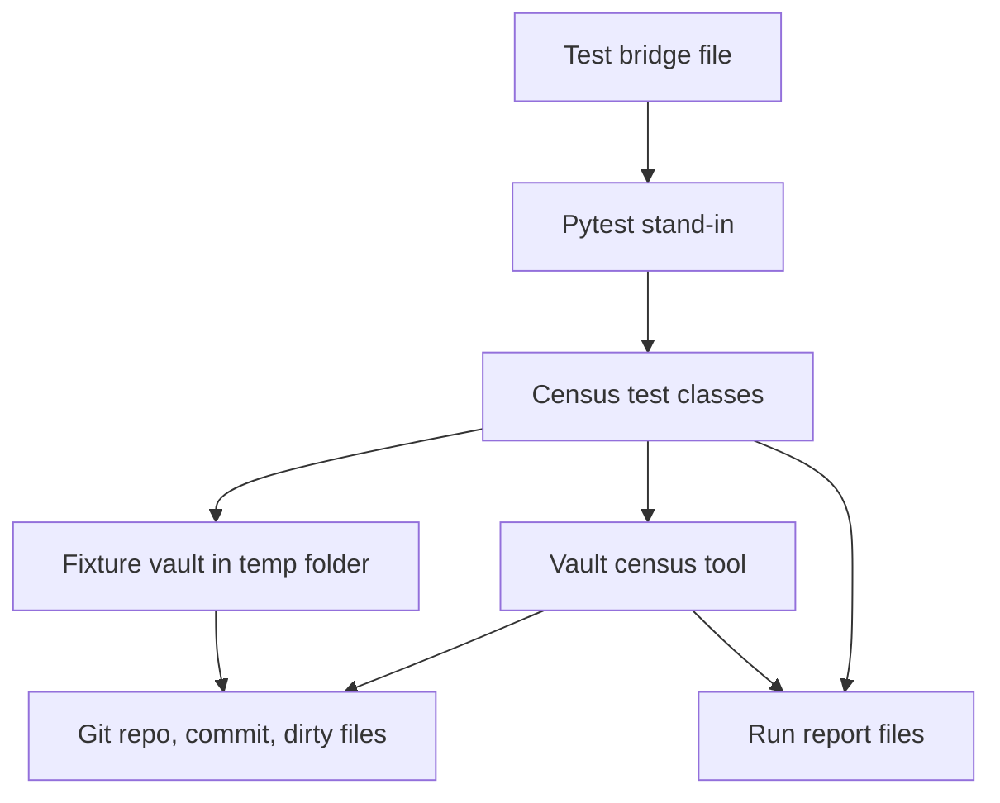

## Purpose

This file tests the vault census, a read-only tool that walks a vault, counts how many notes carry the four retrieval fields in their frontmatter, and checks run reports against a table of rules (the "kind rows" K1 to K13 for ticket files). The tests build small fixture vaults in temporary folders and prove four things: the counts are right, the report check catches every kind of wrong write, the tool never writes or leaks content, and the tool and its tests follow the repo's coding standards. The file is written in pytest style but runs on a small stand-in, so it needs the bridge file to be picked up by the unittest runner.

## Dependencies

**Depends on.**
- Standard library: `ast`, `hashlib`, `json`, `logging`, `os`, `subprocess`, `sys`, `typing`, `pathlib` {src:tests/scripts/state/test_vault_census.py:21-29}.
- The pytest stand-in, imported under the name `pytest`: `minipytest` in the same folder (no doc yet) {src:tests/scripts/state/test_vault_census.py:31}.
- The tool under test, put on the path from `scripts/state`: [[vault_census]] / [vault_census](../../../scripts/state/vault_census.md) {src:tests/scripts/state/test_vault_census.py:33-34}.
- `git` on the path, used to build fixture repositories {src:tests/scripts/state/test_vault_census.py:234-237}. The tool needs PyYAML {src:scripts/state/vault_census.py:36}.
- It does not import the backfill tool, and a test proves that {src:tests/scripts/state/test_vault_census.py:1207-1213}.

**Used by.** Searched with `git grep` for the file name and module name outside `docs/` (2026-11-20).
- Product code: none.
- Automation: the bridge file lists this module and turns each test function into a unittest case {src:tests/scripts/state/test_pytest_bridge.py:16-17} {src:tests/scripts/state/test_pytest_bridge.py:29-32}. The state area runner finds the bridge by the pattern `test_*.py` {src:tests/scripts/state/run.sh:6}, and the end-to-end runner runs that area {src:tests/system/run.sh:22-23}. The file has no `unittest` classes of its own, so run alone under unittest it would collect nothing (the classes at {src:tests/scripts/state/test_vault_census.py:316} are plain classes).
- Tests: `test_state_tools.py` also calls the census functions {src:tests/scripts/state/test_state_tools.py:278-292}; `test_backfill_nonticket_policy.py` calls `folder_triple` and the scope A count {src:tests/scripts/state/test_backfill_nonticket_policy.py:568} {src:tests/scripts/state/test_backfill_nonticket_policy.py:593}.

## Behavior

**Fixtures.** The rule cases are typed here as literals, apart from the census table: 43 `(row, path, triple)` cases {src:tests/scripts/state/test_vault_census.py:57-101}, plus 16 paths that must match no row {src:tests/scripts/state/test_vault_census.py:102-119}. A known-counts vault of 25 markdown files {src:tests/scripts/state/test_vault_census.py:191} is built from `FIXTURE_FILES`, one symlink, one dirty file and one untracked file {src:tests/scripts/state/test_vault_census.py:139-179}. `make_vault` writes the files, runs `git init`, adds and commits them, then dirties and adds files {src:tests/scripts/state/test_vault_census.py:249-266}. Git runs with the system and global config switched off, an explicit identity, no hooks and no signing {src:tests/scripts/state/test_vault_census.py:229-237}. The known vault is shared by many tests through one module-scoped fixture, with a comment that tests must not change it {src:tests/scripts/state/test_vault_census.py:269-275}.

**TestKindRowTriples.** Each of the 43 paths gets its row's triple, whether the frontmatter is `None` or empty {src:tests/scripts/state/test_vault_census.py:317-320}; each of the 13 rows appears in the cases {src:tests/scripts/state/test_vault_census.py:322-323}; each of the 16 no-row paths returns `None` {src:tests/scripts/state/test_vault_census.py:325-327}. Matching ignores case and removes only the folder prefix once (`T-1-T-1-spec.md` matches nothing) {src:tests/scripts/state/test_vault_census.py:329-331}. When rows overlap, the first wins: a spec under `archive/` is the archive row, and `cursor-spec.md` is a review {src:tests/scripts/state/test_vault_census.py:333-335}. The code walks the rows in order and stops at the first match {src:scripts/state/vault_census.py:388-392}.

**TestTerminalOverride.** A status of `cancelled`, `superseded`, `dropped`, `archived` or `absorbed`, in any case and padded, forces `indexable` false {src:tests/scripts/state/test_vault_census.py:344-349}. Other values (`parked`, `closed`, `shipped`, empty, the placeholder `active | archived`) and non-string values leave the row alone {src:tests/scripts/state/test_vault_census.py:351-359}. The override never creates a row for a path that has none {src:tests/scripts/state/test_vault_census.py:365-366}. Code: {src:scripts/state/vault_census.py:62-64} {src:scripts/state/vault_census.py:369-376}.

**TestFrontmatterFacts.** All four fields, even with `indexed: null`, is `with_all_four`; one to three is `with_some`; none is `with_none` {src:tests/scripts/state/test_vault_census.py:375-382}. Windows line endings and a closing line at the end of the file parse {src:tests/scripts/state/test_vault_census.py:384-387}. Seven shapes count as no frontmatter: empty, plain text, a leading blank line, a byte order mark, no closing line, and padded opening or closing lines {src:tests/scripts/state/test_vault_census.py:389-396}. Eight bad YAML shapes are counted as `unparseable` and never raised {src:tests/scripts/state/test_vault_census.py:398-406}. Code: {src:scripts/state/vault_census.py:396-444}.

**TestScanCounts.** The known vault gives exactly the expected total and per-folder counts {src:tests/scripts/state/test_vault_census.py:418-427}; the result has only the documented keys and `exclusions == ["memory/"]` {src:tests/scripts/state/test_vault_census.py:429-432}; every file lands in exactly one class so the parts add up to `files` {src:tests/scripts/state/test_vault_census.py:434-442}; folder sums equal the totals {src:tests/scripts/state/test_vault_census.py:444-447}; a file without a key adds nothing to that key, and the labels `null` and `None` never appear {src:tests/scripts/state/test_vault_census.py:449-455}. Hidden folders are pruned at the vault root only {src:tests/scripts/state/test_vault_census.py:457-462} {src:scripts/state/vault_census.py:472-489}. A folder symlink is not followed {src:tests/scripts/state/test_vault_census.py:464-468}. A non-markdown file is ignored {src:tests/scripts/state/test_vault_census.py:470-471}. Odd values become the closed labels `<unsafe>`, `<non-string>` and `<non-bool>`, so no free text reaches the output {src:tests/scripts/state/test_vault_census.py:473-483} {src:scripts/state/vault_census.py:565-578}.

**TestTerminalCount.** A terminal status with `indexable` exactly `true` is counted {src:tests/scripts/state/test_vault_census.py:494-500}; values outside the rule, `indexable` false, the string `'true'`, the number 1, or a missing line are not {src:tests/scripts/state/test_vault_census.py:502-516}. The unknown-catalog count includes ticket files only {src:tests/scripts/state/test_vault_census.py:518-526} {src:scripts/state/vault_census.py:603-605}.

**TestInScope.** A file that misses a field counts as in scope only when it is tracked, clean, parseable and has a kind row; the twelve cases (missing all, missing one, complete, untracked, dirty, unparseable, no row, loose, outside tickets, archive, history, deep state) each carry the expected number {src:tests/scripts/state/test_vault_census.py:529-558}. A staged but uncommitted change is not clean {src:tests/scripts/state/test_vault_census.py:560-565}; a terminal status does not take a file out of scope {src:tests/scripts/state/test_vault_census.py:567-569}. Code: {src:scripts/state/vault_census.py:541-550}.

**TestUnreadable.** A file with mode 0 is counted as `unreadable` and not raised; skipped when the user is root {src:tests/scripts/state/test_vault_census.py:573-582}. A file of kind unreadable, symlink or unparseable is never in scope, while a file with no frontmatter is {src:tests/scripts/state/test_vault_census.py:584-589} {src:scripts/state/vault_census.py:546-547}.

**TestCheckWrites.**
- One file per row with its literal triple gives 13 checked and no mismatch {src:tests/scripts/state/test_vault_census.py:609-613}.
- Flipping `indexable` on any one of the 13 rows gives exactly one `TRIPLE_DIFFERS` and that path {src:tests/scripts/state/test_vault_census.py:615-625}. A wrong catalog type or role, a string `'true'` or the integer 1 are also mismatches {src:tests/scripts/state/test_vault_census.py:627-644} {src:scripts/state/vault_census.py:690-695}.
- A terminal status file must carry `indexable` false {src:tests/scripts/state/test_vault_census.py:646-654}. A `flip` entry is counted and skipped {src:tests/scripts/state/test_vault_census.py:656-662} {src:scripts/state/vault_census.py:771-773}. Several reports are summed {src:tests/scripts/state/test_vault_census.py:664-669}.
- Five failures of the written file each have a closed code: `FILE_UNREADABLE`, `NO_FRONTMATTER`, `FRONTMATTER_UNPARSEABLE`, `FIELD_MISSING`, `INDEXED_NOT_NULL` {src:tests/scripts/state/test_vault_census.py:671-692} {src:scripts/state/vault_census.py:698-714}. Mismatch paths come back sorted {src:tests/scripts/state/test_vault_census.py:694-699} {src:scripts/state/vault_census.py:781}. A path with no row gives `NO_KIND_ROW` {src:tests/scripts/state/test_vault_census.py:701-705}. A symlinked target is not followed {src:tests/scripts/state/test_vault_census.py:707-713}.
- Seven unsafe path values (absolute, `..`, empty, `None`, a number, a backslash) give `PATH_UNSAFE` and the bad path is not echoed {src:tests/scripts/state/test_vault_census.py:715-725} {src:scripts/state/vault_census.py:680-687}. A malformed entry or an unknown class gives `MALFORMED_ENTRY` {src:tests/scripts/state/test_vault_census.py:732-736} {src:scripts/state/vault_census.py:725-734}.
- A bad report raises a closed code before any file is checked: not found, unreadable, unparseable, or wrong shape {src:tests/scripts/state/test_vault_census.py:738-763} {src:scripts/state/vault_census.py:647-666}.

**TestMain and TestCommandLine.** The scan prints one JSON document equal to `scan_vault` {src:tests/scripts/state/test_vault_census.py:767-773}. `--check-writes` prints only the check result {src:tests/scripts/state/test_vault_census.py:775-782}. Mismatches leave the exit code at 0 {src:tests/scripts/state/test_vault_census.py:784-790}. A bad report, a vault root that is not a folder, and git failures (not a repository, no commit, git missing, git timeout) exit 2, print nothing on stdout and log one closed code {src:tests/scripts/state/test_vault_census.py:792-858} {src:scripts/state/vault_census.py:808-826}. Abbreviated flags and a missing `--vault-root` are argument errors {src:tests/scripts/state/test_vault_census.py:809-825} {src:scripts/state/vault_census.py:791-805}. Only the git commands `ls-files` and `diff` are used {src:tests/scripts/state/test_vault_census.py:860-873} {src:scripts/state/vault_census.py:127-130}, and git runs with `GIT_OPTIONAL_LOCKS=0` {src:tests/scripts/state/test_vault_census.py:875-887} {src:scripts/state/vault_census.py:513-514}. Run as a script, the first stderr line starts `INFO scanned=25 ` {src:tests/scripts/state/test_vault_census.py:898-904} {src:scripts/state/vault_census.py:177}.

**TestCanary.** A marker string is planted in bodies, odd frontmatter values, bad YAML and a report; the test fails if it shows in stdout, stderr or logs, in the scan, the check, the script and the bad-report error {src:tests/scripts/state/test_vault_census.py:922-983}. A final test proves the planted marker sits in 7 files {src:tests/scripts/state/test_vault_census.py:985-988}.

**TestReadOnly.** A scan and a check leave every file, the symlinks and `.git/index` unchanged by content hash and nanosecond mtime {src:tests/scripts/state/test_vault_census.py:1045-1055}. A snapshot helper is itself tested to notice a changed byte and a changed mtime {src:tests/scripts/state/test_vault_census.py:1057-1069}. A syntax tree scan finds no call that could write in the census source, and is tested on eight writing shapes and on the allowed `sys.stdout.write` and read modes {src:tests/scripts/state/test_vault_census.py:1071-1090}.

**TestIndependence and TestLocalOnly.** Neither the census nor this file imports the backfill tool {src:tests/scripts/state/test_vault_census.py:1207-1213}; the census holds one kind table named `KIND_ROWS` {src:tests/scripts/state/test_vault_census.py:1220-1222}; this file never reads `KIND_ROWS`, `ROLE_ROWS` or `KindRow` through the `census` name {src:tests/scripts/state/test_vault_census.py:1224-1227}; the literal case list is a plain list of tuples {src:tests/scripts/state/test_vault_census.py:1234-1240}. The census imports only an allowlist of modules {src:tests/scripts/state/test_vault_census.py:1093-1096} {src:tests/scripts/state/test_vault_census.py:1268-1269}, and a fresh Python that imports it loads no network, model or backfill module {src:tests/scripts/state/test_vault_census.py:1286-1287}. The checkers are tested on bad sources (socket, `urllib.request`, `__import__`, `shutil`) and on a probe that must see a loaded `socket` {src:tests/scripts/state/test_vault_census.py:1271-1293}.

**TestStandards.** The census and this file must have typed functions of at most 40 lines and no `print` {src:tests/scripts/state/test_vault_census.py:1302-1304}, carry the six header labels in the first 40 lines and no unfinished marker {src:tests/scripts/state/test_vault_census.py:1306-1308}, and use no `match` statement or bar union in an annotation {src:tests/scripts/state/test_vault_census.py:1310-1312}. Six more tests check the checkers on small bad sources {src:tests/scripts/state/test_vault_census.py:1314-1342}.

## Diagram

## Notes

- **Code and description.**
  - The header lists the test classes {src:tests/scripts/state/test_vault_census.py:12-14}; the file also holds `TestTerminalCount` {src:tests/scripts/state/test_vault_census.py:493}, which is not in that list.
  - The header says fixtures are built "in pytest temp folders" {src:tests/scripts/state/test_vault_census.py:3}; pytest is not used, the temp folders come from the stand-in {src:tests/scripts/state/test_vault_census.py:31} {src:tests/scripts/state/minipytest.py:274}.
  - The header says the AST test proves the file "never reads the census table" {src:tests/scripts/state/test_vault_census.py:5-6}; the check only looks for the attribute names `KIND_ROWS`, `ROLE_ROWS` and `KindRow` on a name `census` {src:tests/scripts/state/test_vault_census.py:1224-1227}. A read of `FOLDER_ROWS` {src:scripts/state/vault_census.py:297}, a `from vault_census import ...` or a `getattr` would pass.
  - The `Date:` header line is empty {src:tests/scripts/state/test_vault_census.py:11}.
- **Coverage gaps in this file.** The run 4 report path (`is_nonticket_report`, `count_scope_a_missing`, `folder_triple`) is not exercised here {src:scripts/state/vault_census.py:674-683} {src:scripts/state/vault_census.py:737-752}; another test file covers it {src:tests/scripts/state/test_backfill_nonticket_policy.py:568-631}.
- **Self-checks.** Several tests check only the test file's own helpers or constants, for example the rows-covered test and the test that the canary vault holds the marker {src:tests/scripts/state/test_vault_census.py:322-323} {src:tests/scripts/state/test_vault_census.py:985-988}. They fail only if the test file is edited wrongly, which is their purpose. No test here passes whatever the code does.
- **Machine and version dependence.**
  - `os.geteuid` is evaluated when the file loads, so the file does not import on a system without it {src:tests/scripts/state/test_vault_census.py:573}.
  - The "not a git repository" test fails if the temporary folder sits inside another git work tree, because git then finds the outer repository {src:tests/scripts/state/test_vault_census.py:827-833} {src:scripts/state/vault_census.py:518}.
  - `GIT_CONFIG_GLOBAL` is only honoured by newer git [uncertain: version not checked] {src:tests/scripts/state/test_vault_census.py:229}.
  - Python 3.10 is needed for the `match` test, which is skipped below that {src:tests/scripts/state/test_vault_census.py:1339-1342}.
  - The `INFO scanned=25 ` check depends on the log format {src:scripts/state/vault_census.py:177}.
- **Inputs without a check.** Every path passed to the tool or to git is built from a temporary folder by the test; commands run from lists, never through a shell {src:tests/scripts/state/test_vault_census.py:236} {src:tests/scripts/state/test_vault_census.py:893}. The tool's own input checks are the subject of the unsafe path tests.
- **Shared file writes.** The tests write only under temporary folders, which the stand-in removes on close {src:tests/scripts/state/minipytest.py:274} {src:tests/scripts/state/minipytest.py:284}. Two writes touch the tree they test: `chmod` to mode 0 is restored in a `finally` block {src:tests/scripts/state/test_vault_census.py:577-581}, and the shared vault must not be changed, which is a comment and not enforced {src:tests/scripts/state/test_vault_census.py:271}. Nothing is atomic or locked; tests run one at a time.
