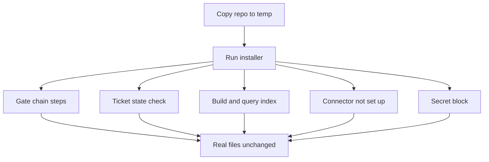

## Purpose

This is the end to end check for Tollgate. It installs a copy of the repo into a throwaway home folder under a made-up user name, then walks one small scenario through it: a synthetic ticket passes the gate chain, the ticket state check runs, a search index is built and queried, one connector reports that it is not set up, and one hook blocks a fake secret. A last test confirms that the real settings file, and optionally the real vault folders, did not change during the run.

## Dependencies

**Depends on.**
- Standard library: `json`, `os`, `shutil`, `subprocess`, `sys`, `tempfile`, `unittest` {src:tests/system/test_e2e.py:16-22}.
- `RealStateGuard`, `file_checksum` and `folder_checksum` from the test harness, found by adding `tests/harness` to `sys.path` {src:tests/system/test_e2e.py:26} {src:tests/system/test_e2e.py:28}. Page: [[real_guard]] / [real_guard](../harness/real_guard.md).
- The installer, run with fixed flags {src:tests/system/test_e2e.py:81-85}. Page: [[install]] / [install](../../install.md).
- The gate hook, run as a program {src:tests/system/test_e2e.py:128}. Page: [[pre-prompt-expansion-check-gates]] / [pre-prompt-expansion-check-gates](../../hooks/pre-prompt-expansion-check-gates.md).
- The secret scanner hook {src:tests/system/test_e2e.py:192}. Page: [[scrub_secrets]] / [scrub_secrets](../../hooks/scrub_secrets.md).
- The ticket state check {src:tests/system/test_e2e.py:153}. Page: [[ticket_state_check]] / [ticket_state_check](../../scripts/state/ticket_state_check.md).
- The index builder and query script {src:tests/system/test_e2e.py:169} {src:tests/system/test_e2e.py:173}. Pages: [[build_index]] / [build_index](../../scripts/search/build_index.md) and [[query_index]] / [query_index](../../scripts/search/query_index.md).
- The Plane connector entry point {src:tests/system/test_e2e.py:181}. Page: [[plane_sync]] / [plane_sync](../../scripts/connectors/plane/plane_sync.md).
- Outside programs: `tar` and `sh` (the copy step uses a shell pipe) {src:tests/system/test_e2e.py:78-79}, `bash` {src:tests/system/test_e2e.py:82}.
- Environment: `TOLLGATE_REAL_VAULT` {src:tests/system/test_e2e.py:65} and `TOLLGATE_TEST_PYTHON` {src:tests/system/test_e2e.py:160}, both optional.

**Used by.** No product code. Searched `git grep` for `test_e2e`, `tests/system` and `system/run` outside `docs/` on 2026-11-20.
- Tests and runners: started by `tests/system/run.sh`, which discovers it by file name {src:tests/system/run.sh:16}.

## Behavior

**Set up (once for the whole class).**
- Records a checksum of the real settings file {src:tests/system/test_e2e.py:63-64}. If `TOLLGATE_REAL_VAULT` is set, it also records checksums of that vault's `01-system-map` and `02-tickets` folders {src:tests/system/test_e2e.py:65-67}.
- Makes a temporary root, a fake home named `e2e_stranger`, and a fake `security` program that only appends its arguments to a log {src:tests/system/test_e2e.py:69-75}.
- Copies the repo into the temporary folder with `tar`, leaving out `.git`, `__pycache__` and `ticket_states` {src:tests/system/test_e2e.py:78-79}.
- Runs `install.sh --non-interactive` with a made-up name, a vault inside the temporary root, initials `as` and ticket prefix `tk`, with a 120 second limit {src:tests/system/test_e2e.py:33} and no keyboard input {src:tests/system/test_e2e.py:81-85}.
- Loads the `settings.json` the installer wrote in the fake home, if it exists {src:tests/system/test_e2e.py:86-91}.
- The child environment drops every `TOLLGATE_*` variable and the Claude folder variables, then sets `HOME`, `USER`, `LOGNAME`, a null git config, and puts the fake `bin` folder first on `PATH` {src:tests/system/test_e2e.py:46-52}. For the steps below, `TOLLGATE_HOME`, `TOLLGATE_KNOWLEDGE` and `TOLLGATE_NONINTERACTIVE` are set last and so win over the installed settings {src:tests/system/test_e2e.py:98-101}.
- Tear down deletes the temporary root and ignores errors {src:tests/system/test_e2e.py:95}.

**Test cases.**
1. `test_01_install_ok`: the installer exits 0 {src:tests/system/test_e2e.py:108}; `settings.json` has hooks {src:tests/system/test_e2e.py:109}; its env block has `TOLLGATE_KNOWLEDGE` and no `TOLLGATE_SKILL_PREFIX` {src:tests/system/test_e2e.py:110} {src:tests/system/test_e2e.py:111}; the hook commands point into the installed copy and not at the source repo {src:tests/system/test_e2e.py:113} {src:tests/system/test_e2e.py:114}.
2. `test_02_gate_chain`: writes small ticket files, each with one `Status:` line {src:tests/system/test_e2e.py:117-121}, and calls the gate hook for each step. The gate's answer counts as "blocked" only when the hook prints JSON whose `decision` is `block` {src:tests/system/test_e2e.py:132}. The command name is built as `tg-` plus the skill {src:tests/system/test_e2e.py:124}, matching the hook's own prefix {src:hooks/pre-prompt-expansion-check-gates.py:61}.
   - `spec` is not gated {src:tests/system/test_e2e.py:136}, because only `arch`, `dev` and `qa` are gated {src:hooks/pre-prompt-expansion-check-gates.py:71}.
   - `arch` is blocked until the spec file carries the approved status and the state file carries the spec-approved value {src:tests/system/test_e2e.py:137-140}, matching the rule {src:hooks/gate_rules.py:191-192}.
   - `dev` is blocked until the design file carries the design-approved status and the state agrees {src:tests/system/test_e2e.py:141-144}, matching the rule {src:hooks/gate_rules.py:201-202}.
   - `qa` is blocked when the state says development is finished but no validation file exists, and passes once a validation file with status `DOCUMENTED` appears {src:tests/system/test_e2e.py:145-148}, matching the rule {src:hooks/gate_rules.py:213-216}.
3. `test_03_ticket_state_check`: runs the state check script on the ticket and accepts exit code 0 or 1, and requires that stderr has no `Traceback` {src:tests/system/test_e2e.py:152-156}. The script returns its setup code for a bad key, no tickets folder or no ticket folder {src:scripts/state/ticket_state_check.py:159} {src:scripts/state/ticket_state_check.py:164} {src:scripts/state/ticket_state_check.py:168}, and the problem code only when an error finding exists {src:scripts/state/ticket_state_check.py:180}, and the codes are 0, 1 and 2 {src:scripts/state/ticket_state_check.py:61}, so this test fails on exit 2 or a crash.
4. `test_04_search`: skipped unless `TOLLGATE_TEST_PYTHON` names an existing file {src:tests/system/test_e2e.py:160-162}. Otherwise it writes three short notes into the vault {src:tests/system/test_e2e.py:163-167}, builds the index with `--full --embedder hash` {src:tests/system/test_e2e.py:169-171}, queries "how often are failed jobs retried" with `--top 3` {src:tests/system/test_e2e.py:173-175}, and requires exit 0 and the text `retry-policy` in the output {src:tests/system/test_e2e.py:176} {src:tests/system/test_e2e.py:177}. The comment says each note is longer than the 80 character chunk minimum {src:tests/system/test_e2e.py:34}; the minimum is 80 {src:scripts/search/config.py:69}.
5. `test_05_connector_not_set_up`: runs `plane_sync.py drift` and requires a non-zero exit and the words `not set up` in the output {src:tests/system/test_e2e.py:181-184}. The connector raises that error when it is not switched on and the run is not interactive {src:scripts/connectors/plane/cli.py:162-163}, with the message text from {src:scripts/connectors/registry.py:326}, and exits 2 {src:scripts/connectors/plane/cli.py:195-197} {src:scripts/connectors/plane/cli.py:39}.
6. `test_06_hook_blocks_a_secret`: builds a fake Anthropic style key in pieces so the file itself holds no key-shaped text {src:tests/system/test_e2e.py:188}, sends it to the scanner as a pending file write {src:tests/system/test_e2e.py:189-191}, and requires `deny` in the output and the key absent from it {src:tests/system/test_e2e.py:194} {src:tests/system/test_e2e.py:195}. The hook has a pattern for keys of that shape {src:hooks/scrub_secrets.py:51} and denies writes that contain one {src:hooks/scrub_secrets.py:214-223}.
7. `test_zz_real_state_untouched` (E2E-02): the settings checksum recorded at start still matches {src:tests/system/test_e2e.py:199}; each real vault folder checksum matches {src:tests/system/test_e2e.py:200-201}; and the real `~/.claude/settings.json` checksum matches the recorded one a second time {src:tests/system/test_e2e.py:202-203}. The comment says it runs last because its name sorts after the others {src:tests/system/test_e2e.py:197}. That relies on unittest running methods in alphabetical order {src:docs:https://docs.python.org/3/library/unittest.html}.

## Diagram

## Notes

**Code and description disagree.**
- The module docstring says the class proves "the real settings file and the real vault folders are the same before and after" {src:tests/system/test_e2e.py:7-8}. The vault check runs only when `TOLLGATE_REAL_VAULT` is set {src:tests/system/test_e2e.py:65-66}, and the guard is built with no vault path {src:tests/system/test_e2e.py:63} {src:tests/harness/real_guard.py:51-55}. By default only the settings file is checked.
- The comment above the corpus says each body is longer than the minimum chunk length {src:tests/system/test_e2e.py:34}. The test never asserts the length; if a body were shortened, the failure would show only as a missing search hit.
- The `date:` header line is empty {src:tests/system/test_e2e.py:10}.

**Tests that cannot fail, or fail for the wrong reason.**
- The "allowed" assertions in `test_02` (`assertFalse(self.gate(...))`) are true for any output that is not a `block` decision {src:tests/system/test_e2e.py:132}. The gate also allows, with a warning, when it cannot find the ticket or the vault variable {src:hooks/pre-prompt-expansion-check-gates.py:345-363} and then prints a `systemMessage` {src:hooks/pre-prompt-expansion-check-gates.py:454-455}. The earlier "blocked" assertions in the same test prove the lookup works at that point, so the weakness is partial.
- `test_03` only proves the script does not crash {src:tests/system/test_e2e.py:155} {src:tests/system/test_e2e.py:156}. It never reads the script output.
- `test_04` queries 3 results from an index that holds the three notes written by the test {src:tests/system/test_e2e.py:163-175}, plus whatever the installer seeded into the vault (not checked here). If the index holds only three chunks, `retry-policy` would appear in the top 3 whatever the ranking. So the test shows the index builds and answers, not that ranking is right. The query script prints the file name, which is what the test matches {src:scripts/search/query_index.py:70}.
- `test_zz`: lines 199 and 202-203 check the same file, since the guard's default settings path is the real home settings file {src:tests/harness/real_guard.py:46-47}. The second check adds nothing.
- The isolation depends on the test process keeping its real `HOME`: only child processes get the fake one {src:tests/system/test_e2e.py:49}. The guard cannot see writes outside the settings file and the two vault folders.
- Test 04 depends on the machine: it is skipped without a Python that has the search packages {src:tests/system/test_e2e.py:160-162}. Tests 03 and 05 run with the interpreter running the tests, not `TOLLGATE_TEST_PYTHON` {src:tests/system/test_e2e.py:153} {src:tests/system/test_e2e.py:181}. The hook steps run the hook files directly as programs {src:tests/system/test_e2e.py:129} {src:tests/system/test_e2e.py:192}, which needs their execute bit and a `python3` on `PATH`, where `PATH` is the real one with the fake `bin` in front {src:tests/system/test_e2e.py:52}. The fake `SHELL` value is only text {src:tests/system/test_e2e.py:49}. No Python version beyond what the scripts need is assumed.
- Coverage gap: the ticket files are put in a flat folder `02-tickets/TK-001` {src:tests/system/test_e2e.py:118}. The gate hook also looks in prefix folders `02-tickets/PREFIX/KEY` {src:hooks/pre-prompt-expansion-check-gates.py:196-198} {src:hooks/pre-prompt-expansion-check-gates.py:207-209}, and that layout is not tested here.

**Inputs that reach a command or path without a check.**
- `REPO` (from the file location) and the temporary repo folder are put straight into a shell command string with `shell=True`, unquoted {src:tests/system/test_e2e.py:78-79}. A path with spaces would break it. Both values come from the file location and `tempfile`, not from outside input.
- `TOLLGATE_TEST_PYTHON` is run as a program after only an `isfile` check {src:tests/system/test_e2e.py:160-161} {src:tests/system/test_e2e.py:169}.
- `TOLLGATE_REAL_VAULT` is joined into folder paths that are read with no check on the value {src:tests/system/test_e2e.py:65-66}. The reads do not write.
- The installer arguments and the key are fixed text {src:tests/system/test_e2e.py:82-83}. No network address is built from input.

**Writes to shared files.** All writes go under the temporary root: the fake `security` log {src:tests/system/test_e2e.py:74}, the ticket files {src:tests/system/test_e2e.py:120} and the search notes {src:tests/system/test_e2e.py:166}. The temporary root comes from `mkdtemp`, so two runs do not share it {src:tests/system/test_e2e.py:69}. The writes are plain `open(..., "w")`, not atomic, and nothing stops two writers, but within one run each step is sequential. The installer and index builder write inside the fake home and vault. A bug that made them write to the real home would be caught only for the settings file.
