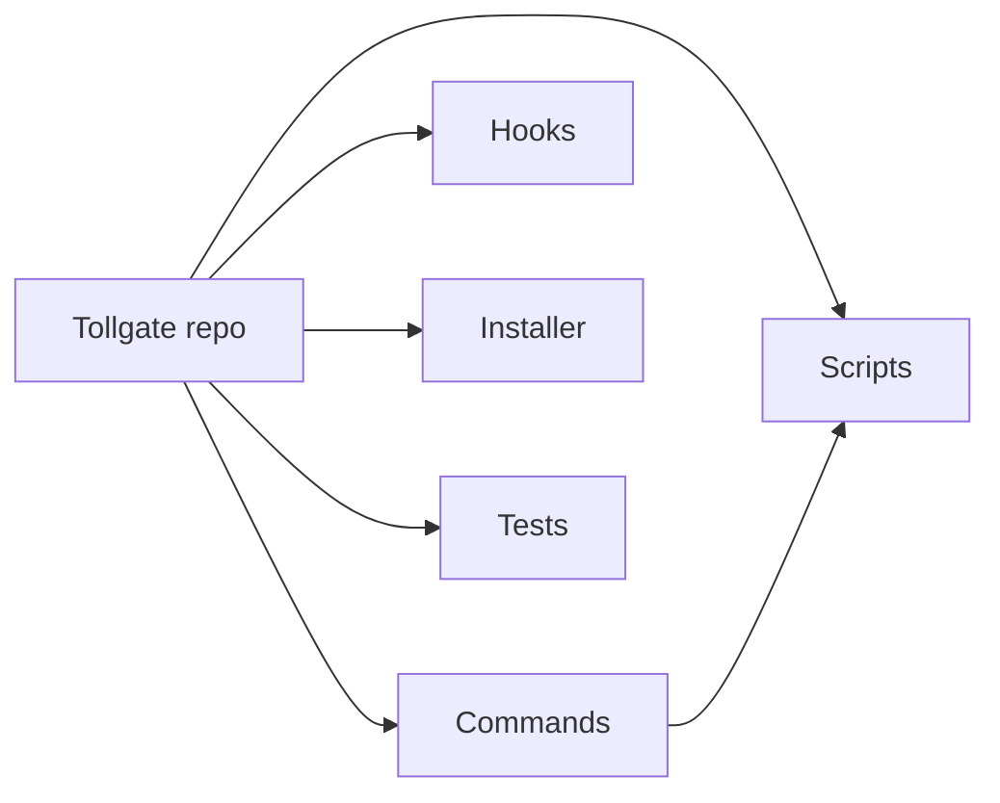

## Modules

One entry per documented source file (page path under `docs/` mirrors the source path). Commands are listed by their command file.

- [.github/dependabot.yml](.github/dependabot.md) - Dependabot settings: weekly updates for GitHub Actions and the scripts folder pip files.
- [.github/workflows/tests.yml](.github/workflows/tests.md) - A GitHub Actions workflow named `tests`.
- [commands/tg-arch.md](commands/arch.md) - It turns an approved spec into an approved design: the approach, why it holds up, and a plan split into small work blocks. Use it after `/tg-spec`
- [commands/tg-close.md](commands/close.md) - It closes a work block: it drafts the session log, vault notes and memory files, asks you to confirm one log entry, then writes the vault files and
- [commands/tg-dev.md](commands/dev.md) - Builds one work block of an approved design and hands back a reviewed, squash-merged branch. It never re-designs .
- [commands/tg-devops.md](commands/devops.md) - Plans and checks the way code moves from a repo to a running system, and refuses to deploy to production without your explicit yes .
- [commands/tg-doc-gen.md](commands/doc-gen.md) - Writes structured documentation for one source file, to the repo and the vault in the same run, with every behavior claim tied to a source line .
- [commands/tg-draft.md](commands/draft.md) - It writes a message for another person (Jira, Slack, email or Notion) in your voice and shows it to you. You review it; nothing is sent. Use it fo
- [commands/tg-explain.md](commands/explain.md) - It explains the last code change in plain words, in under 250 words. Use it right after a dev block commits, when you want to know what was built
- [commands/tg-explore.md](commands/explore.md) - It reads what already exists about a topic (vault, Confluence, Git, Slack), shows you what it found, and after you confirm writes a system-map note.
- [commands/tg-handoff.md](commands/handoff.md) - It writes the next skill's starter prompt into the ticket's state file and shows the prompt in chat. Use it between two steps of the ticket chain,
- [commands/tg-influence.md](commands/influence.md) - It rewrites your own message so it is clearer and the tone fits, and tells you why for each change. It does nothing else .
- [commands/tg-learn.md](commands/learn.md) - It teaches you one concept at a time and leaves a learning note behind. Use it to build a real mental model of your own systems. It asks first, co
- [commands/tg-pr-review.md](commands/pr-review.md) - Reads someone else's pull request, writes a brief, and drafts up to three comments. It posts nothing: you decide what to post .
- [commands/tg-pull-notes.md](commands/pull-notes.md) - It copies new exported meeting notes from a folder you name into the local meetings folder. Use it after you export notes from your meeting tool.
- [commands/tg-qa.md](commands/qa.md) - Reviews the whole merged change as an adversary, runs the validation scenarios, and ends with a verdict and a routing slip. It never fixes anything .
- [commands/tg-reference-import.md](commands/reference-import.md) - Copies reference material into your library, writes its README and index, maps it to situations, and adds it to the search with your tags.
- [commands/tg-retrieve.md](commands/retrieve.md) - Looks up passages from the search index and hands them to the conversation as context .
- [commands/tg-save.md](commands/save.md) - It writes a quick checkpoint of the session to the session log so any AI, or the next session, can pick the work up if things crash or context runs
- [commands/tg-spec.md](commands/spec.md) - It turns a ticket into a written, owner-approved spec: what to build and how to prove it works. Use it first, before any design. It does not desig
- [commands/tg-sre.md](commands/sre.md) - Helps you define what reliable means for a pipeline: targets, error budgets, alerts, runbooks and postmortems .
- [commands/tg-start.md](commands/start.md) - It opens a work session: it checks the date, the vault and the open blockers, then shows a short agenda. Use it at the start of a session. It chan
- [commands/tg-status.md](commands/status.md) - It shows the current state of a client or a ticket. Client mode adds talking points for stakeholder questions; ticket mode gives a short sheet to ke
- [commands/tg-support.md](commands/support.md) - Use it to find out why something is wrong, and to decide where the ticket goes next. It diagnoses. It never designs a fix and never changes code .
- [commands/tg-sweep.md](commands/sweep.md) - Moves everything waiting in the knowledge staging area into the vault and the search index, then prints one count line .
- [commands/tg-sync.md](commands/sync.md) - It checks open, time-sensitive facts in your active ticket state files, asks you one question per fact, and updates only the facts you verify. Use
- [commands/tg-terraform.md](commands/terraform.md) - Turns manual cloud setup into versioned infrastructure code, and applies nothing until you approve the plan .
- [commands/tg-think-calibrate.md](commands/think-calibrate.md) - A weekly 5 to 10 minute check on how far ahead you reason, with one challenge to carry into the next week .
- [commands/tg-ticket.md](commands/ticket.md) - Use it first on any ticket. It reads everything available, classifies the ticket and tells you which command runs next. It never runs the later steps
- [commands/tg-weekly.md](commands/weekly.md) - It summarizes what moved last Monday to Friday, grouped by client, in three layers: a signal list, a plain-language version for the client, and like
- [commands/tg-whiteboard.md](commands/whiteboard.md) - It tests a new idea and gives a verdict: BUILD, PARK or DROP. Use it before an idea enters your backlog. It is not for client tickets; those go to
- [hooks/claim_patterns.py](hooks/claim_patterns.md) - The shared pattern module for the citation check.
- [hooks/co_authored_by_check.sh](hooks/co_authored_by_check.md) - A PreToolUse hook for Bash.
- [hooks/gate_rules.py](hooks/gate_rules.md) - Pure functions that decide whether a chain skill may start.
- [hooks/gh_pr_create_detect.py](hooks/gh_pr_create_detect.md) - A small helper.
- [hooks/git-pre-push](hooks/git-pre-push.md) - `hooks/git-pre-push` is a git pre-push hook (not a Claude Code hook).
- [hooks/git_ask_before_run.py](hooks/git_ask_before_run.md) - The shared helper behind the commit and push guards.
- [hooks/git_commit_guard.sh](hooks/git_commit_guard.md) - A PreToolUse hook for Bash.
- [hooks/git_push_guard.sh](hooks/git_push_guard.md) - A PreToolUse hook for Bash.
- [hooks/git_readonly_guard.sh](hooks/git_readonly_guard.md) - `hooks/git_readonly_guard.sh` is a Claude Code PreToolUse hook for Bash commands.
- [hooks/guard_worktree_remove.sh](hooks/guard_worktree_remove.md) - A PreToolUse hook for Bash.
- [hooks/lib/protected_paths.py](hooks/lib/protected_paths.md) - The one shared list of Tollgate's own files (user settings, credentials, state and config folders, shell profiles, repo hooks and settings) that the write guard and the Bash guard refuse to let the model write; reads stay allowed.
- [hooks/phi_patterns.py](hooks/phi_patterns.md) - The shared rulebook for finding patient data (PHI) in text.
- [hooks/post-tool-bash-scan-secrets.py](hooks/post-tool-bash-scan-secrets.md) - This is a Claude Code PostToolUse hook.
- [hooks/post-tool-read-record.py](hooks/post-tool-read-record.md) - This is a Claude Code PostToolUse hook for the Read tool.
- [hooks/post-tool-result-scan-phi.py](hooks/post-tool-result-scan-phi.md) - This is a Claude Code PostToolUse hook.
- [hooks/pre-commit-secrets](hooks/pre-commit-secrets.md) - `hooks/pre-commit-secrets` is a git pre-commit hook (not a Claude Code hook).
- [hooks/pre-compact-checkpoint-warn.sh](hooks/pre-compact-checkpoint-warn.md) - This is a Claude Code PreCompact hook.
- [hooks/pre-prompt-expansion-check-gates.py](hooks/pre-prompt-expansion-check-gates.md) - A gate hook that stops the arch, dev and qa chain commands from starting when the earlier `Status:` lines are missing.
- [hooks/pre-submit-vault-inject.sh](hooks/pre-submit-vault-inject.md) - This is the prompt-submit hook that adds vault notes to a conversation.
- [hooks/pre-tool-bash-databricks-ask.py](hooks/pre-tool-bash-databricks-ask.md) - This is the approval gate for Databricks commands that can return or copy row data.
- [hooks/pre-tool-bash-gate-pr-create.py](hooks/pre-tool-bash-gate-pr-create.md) - This hook stops Claude from opening a GitHub pull request until the user has seen the details and said to go ahead.
- [hooks/pre-tool-bash-guard-code-dir.py](hooks/pre-tool-bash-guard-code-dir.md) - A PreToolUse hook for Bash.
- [hooks/pre-tool-bash-guard-gate-override.py](hooks/pre-tool-bash-guard-gate-override.md) - A PreToolUse hook for Bash.
- [hooks/pre-tool-bash-scan-phi.py](hooks/pre-tool-bash-scan-phi.md) - A PreToolUse hook for the Bash tool.
- [hooks/pre-tool-read-ask-sensitive-path.py](hooks/pre-tool-read-ask-sensitive-path.md) - A PreToolUse hook for the Read tool.
- [hooks/pre-tool-write-guard-path.sh](hooks/pre-tool-write-guard-path.md) - A PreToolUse hook for file writes.
- [hooks/pre-tool-write-require-read.py](hooks/pre-tool-write-require-read.md) - This hook makes Claude read a guarded file before it overwrites or edits it.
- [hooks/pre-tool-write-scan-phi.py](hooks/pre-tool-write-scan-phi.md) - This hook keeps patient identifiers out of files that Claude writes.
- [hooks/pre_tool_write_scan_claims.py](hooks/pre_tool_write_scan_claims.md) - A PreToolUse hook that blocks markdown text which states a status as fact with no source.
- [hooks/pre_tool_write_vault_frontmatter.py](hooks/pre_tool_write_vault_frontmatter.md) - A PreToolUse hook for Write, Edit and MultiEdit.
- [hooks/read_guard_common.py](hooks/read_guard_common.md) - This is the shared helper for the read-before-write guard.
- [hooks/scrub_secrets.py](hooks/scrub_secrets.md) - One secret scrubber for two moments.
- [hooks/secret-command-guard.sh](hooks/secret-command-guard.md) - A PreToolUse hook for Bash.
- [hooks/sql_summary.py](hooks/sql_summary.md) - This module turns a SQL statement into a short plain summary for the Databricks approval prompt: which tables, which columns, whether a filter and a r
- [hooks/state_file_io.py](hooks/state_file_io.md) - Two small helpers for code that keeps a shared state file.
- [hooks/vault_doc_standard_check.sh](hooks/vault_doc_standard_check.md) - A PostToolUse hook for Write, Edit and MultiEdit.
- [install.sh](install.md) - One time setup for a new machine, and the same script updates and removes an install.
- [installer/manifest.py](installer/manifest.md) - The installer copies command files into the user's `~/.claude` folder.
- [installer/merge_settings.py](installer/merge_settings.md) - Merges the repo `settings.json` template into the user's `~/.claude/settings.json` without losing the user's own settings.
- [scripts/cache/cache_write.py](scripts/cache/cache_write.md) - This module holds one function that saves a Python dictionary as a JSON file so that a reader never sees a half written file.
- [scripts/cache/daily_brief.py](scripts/cache/daily_brief.md) - This script gathers the small cache files that connectors write, one per source such as a calendar or a tracker, and combines them into one file, `dai
- [scripts/cache/phi_guard.py](scripts/cache/phi_guard.md) - This module checks a list of records for personal health or identity patterns, such as a social security number or a titled patient name, and removes
- [scripts/cache/run_log.py](scripts/cache/run_log.md) - This module keeps one log file of one JSON line per script run, so a person can see when each scheduled script ran and how it ended.
- [scripts/chart/chart_check](scripts/chart/chart_check.md) - This command reads one or more Markdown documents, finds the Mermaid charts in them, and reports each chart that breaks the chart standard: a chart ty
- [scripts/chart/chart_rules.py](scripts/chart/chart_rules.md) - This module reads the chart rules file, `chart_rules.json`, checks that it is well formed, and answers one question: which kinds of chart may a given
- [scripts/chart/data_source.py](scripts/chart/data_source.md) - The data source seam for the report generator.
- [scripts/chart/mermaid_block.py](scripts/chart/mermaid_block.md) - A small command line tool that pulls one fenced `mermaid` block out of a markdown file and copies it to the clipboard without the fence lines, ready t
- [scripts/connectors/__init__.py](scripts/connectors/__init__.md) - An empty package marker.
- [scripts/connectors/comms/__init__.py](scripts/connectors/comms/__init__.md) - An empty package marker.
- [scripts/connectors/comms/calendar_connector.py](scripts/connectors/comms/calendar_connector.md) - The calendar connector.
- [scripts/connectors/comms/commits_connector.py](scripts/connectors/comms/commits_connector.md) - The git commits connector.
- [scripts/connectors/comms/comms_common.py](scripts/connectors/comms/comms_common.md) - The shared helper for the chat, tracker, notes, calendar and git connectors.
- [scripts/connectors/comms/jira_connector.py](scripts/connectors/comms/jira_connector.md) - This is the tracker connector named `jira`.
- [scripts/connectors/comms/notion_connector.py](scripts/connectors/comms/notion_connector.md) - This is the notes connector named `notion`.
- [scripts/connectors/comms/slack_connector.py](scripts/connectors/comms/slack_connector.md) - This is the chat connector named `slack`.
- [scripts/connectors/connect.py](scripts/connectors/connect.md) - This is the one command for connector setup.
- [scripts/connectors/data/__init__.py](scripts/connectors/data/__init__.md) - This file marks the folder `scripts/connectors/data/` as a Python package, so the data connectors `databricks.py` and `secrets_tool.py` can be importe
- [scripts/connectors/data/databricks.py](scripts/connectors/data/databricks.md) - This is the Databricks connector.
- [scripts/connectors/data/secrets_tool.py](scripts/connectors/data/secrets_tool.md) - This is a small command for secrets that are not connector keys: it lists, sets, deletes and bulk deletes entries in the user's own secret store (macO
- [scripts/connectors/plane/__init__.py](scripts/connectors/plane/__init__.md) - Marks the folder `scripts/connectors/plane/` as a Python package, so the other plane files can be imported as `connectors.plane.<name>`.
- [scripts/connectors/plane/__main__.py](scripts/connectors/plane/__main__.md) - The entry point that lets the plane connector run as a package: `python3 -m connectors.plane sync|drift|create ...`.
- [scripts/connectors/plane/cli.py](scripts/connectors/plane/cli.md) - The command line of the plane connector.
- [scripts/connectors/plane/plane_comment_builder.py](scripts/connectors/plane/plane_comment_builder.md) - A set of small text helpers for the plane connector.
- [scripts/connectors/plane/plane_drift_checker.py](scripts/connectors/plane/plane_drift_checker.md) - The `drift` command of the plane connector.
- [scripts/connectors/plane/plane_markdown.py](scripts/connectors/plane/plane_markdown.md) - A small markdown to HTML converter with no outside library.
- [scripts/connectors/plane/plane_sync.py](scripts/connectors/plane/plane_sync.md) - The script you run by file path to use the plane connector: `python3 plane_sync.py sync|drift|create ...`.
- [scripts/connectors/plane/plane_sync_ledger.py](scripts/connectors/plane/plane_sync_ledger.md) - The Plane sync keeps one small JSON file per ticket that remembers what was already sent to the ticket's Plane card: which card it is, a fingerprint o
- [scripts/connectors/plane/plane_sync_settings.py](scripts/connectors/plane/plane_sync_settings.md) - The Plane sync needs a handful of choices that are not secret: which Plane workspace to talk to, which ticket prefixes map to which Plane projects, ho
- [scripts/connectors/plane/plane_ticket_syncer.py](scripts/connectors/plane/plane_ticket_syncer.md) - This is the `sync` command of the Plane connector.
- [scripts/connectors/plane/plane_work_item_client.py](scripts/connectors/plane/plane_work_item_client.md) - A thin client for the few Plane API calls the sync needs: list projects, list board states, list or read work items, create a work item, update one, a
- [scripts/connectors/plane/vault_ticket_creator.py](scripts/connectors/plane/vault_ticket_creator.md) - This is the `create` command of the Plane connector.
- [scripts/connectors/plane/vault_ticket_files.py](scripts/connectors/plane/vault_ticket_files.md) - The vault side of the Plane sync.
- [scripts/connectors/registry.py](scripts/connectors/registry.md) - The central desk for every connector (Plane, Jira, Slack and the others).
- [scripts/connectors/secret_store.py](scripts/connectors/secret_store.md) - Connector keys must live in the user's own secret store and never in a file.
- [scripts/core/__init__.py](scripts/core/__init__.md) - An empty package marker.
- [scripts/core/bootstrap/_worker_common.sh](scripts/core/bootstrap/_worker_common.md) - The shared launcher behind every worker start script.
- [scripts/core/bootstrap/bootstrap-arch-1.sh](scripts/core/bootstrap/bootstrap-arch-1.md) - A one-line wrapper that starts the `arch-1` worker session.
- [scripts/core/bootstrap/bootstrap-arch-2.sh](scripts/core/bootstrap/bootstrap-arch-2.md) - A one-line wrapper that starts the `arch-2` worker session.
- [scripts/core/bootstrap/bootstrap-dev-1.sh](scripts/core/bootstrap/bootstrap-dev-1.md) - A one-line wrapper that starts the `dev-1` worker session.
- [scripts/core/bootstrap/bootstrap-dev-2.sh](scripts/core/bootstrap/bootstrap-dev-2.md) - A one-line wrapper that starts the `dev-2` worker session.
- [scripts/core/bootstrap/bootstrap-dispatch.sh](scripts/core/bootstrap/bootstrap-dispatch.md) - A one-line wrapper that starts the dispatch worker session.
- [scripts/core/bootstrap/bootstrap-qa-1.sh](scripts/core/bootstrap/bootstrap-qa-1.md) - A one-line wrapper that starts the first QA worker session.
- [scripts/core/bootstrap/bootstrap-qa-2.sh](scripts/core/bootstrap/bootstrap-qa-2.md) - A one-line wrapper that starts the second QA worker session.
- [scripts/core/bootstrap/bootstrap-spec-1.sh](scripts/core/bootstrap/bootstrap-spec-1.md) - A one-line wrapper that starts the first spec worker session.
- [scripts/core/bootstrap/bootstrap-spec-2.sh](scripts/core/bootstrap/bootstrap-spec-2.md) - A one-line wrapper that starts the second spec worker session.
- [scripts/core/hooks/precompact_hook.sh](scripts/core/hooks/precompact_hook.md) - A helper meant to be called by a PreCompact hook entry.
- [scripts/core/hooks/session_state_hook.sh](scripts/core/hooks/session_state_hook.md) - A helper meant to be called by a PreCompact hook entry.
- [scripts/core/memory/__init__.py](scripts/core/memory/__init__.md) - This is the package marker for `scripts/core/memory/`.
- [scripts/core/memory/_enums.py](scripts/core/memory/_enums.md) - This file holds fixed value lists and default settings for the memory feature: which scope, confidence, status and data domain values a memory file ma
- [scripts/core/paths.py](scripts/core/paths.md) - This is the path loader.
- [scripts/core/run.sh](scripts/core/run.md) - `run.sh` is a manual button for the three routine vault jobs: flush staging into the vault, convert markdown links to wiki links, and rebuild the sear
- [scripts/core/session_cost.py](scripts/core/session_cost.md) - `session_cost.py` works out what a Claude Code session cost.
- [scripts/core/setup_venv.sh](scripts/core/setup_venv.md) - This script builds the Python virtual environment the search and state scripts need.
- [scripts/core/tg_path](scripts/core/tg_path.md) - `tg_path` is a small command that prints the folder for one logical name, so shell scripts and command files can ask the path loader for a folder with
- [scripts/core/tg_ticket_dir](scripts/core/tg_ticket_dir.md) - `tg_ticket_dir` is a small command that prints the folder of one ticket, so command files and shell scripts can ask for it without knowing whether the vault keeps tickets flat
- [scripts/core/tg_vault_git](scripts/core/tg_vault_git.md) - `tg_vault_git` is a small command line program.
- [scripts/cron/backup_vault.sh](scripts/cron/backup_vault.md) - This script makes one encrypted copy of the whole vault folder per day, keeps it in the output folder under `backups/`, and can place a second copy in
- [scripts/cron/launchd/job.plist.template](scripts/cron/launchd/job.plist.md) - This is the template for a macOS launchd job file (an Apple property list in XML). It holds the fixed parts of a scheduled job and five placeholder ma
- [scripts/cron/launchers/run-all.command](scripts/cron/launchers/run-all.md) - A double click launcher for macOS. Opening `run-all.command` runs the `all` task of the shared runner in a terminal window and keeps the window open u
- [scripts/cron/launchers/run-conversations.command](scripts/cron/launchers/run-conversations.md) - A double click launcher for macOS. Opening `run-conversations.command` runs the `conv` task of the shared runner in a terminal window and keeps the wi
- [scripts/cron/launchers/run-index.command](scripts/cron/launchers/run-index.md) - A double click launcher for macOS. Opening `run-index.command` runs the `index` task of the shared runner in a terminal window and keeps the window op
- [scripts/cron/launchers/run-lint.command](scripts/cron/launchers/run-lint.md) - A double click launcher for macOS. Opening `run-lint.command` runs the `lint` task of the shared runner in a terminal window and keeps the window open
- [scripts/cron/launchers/run-meetings.command](scripts/cron/launchers/run-meetings.md) - A double click launcher for macOS. Opening `run-meetings.command` runs the `meetings` task of the shared runner in a terminal window and keeps the win
- [scripts/cron/launchers/run-repos.command](scripts/cron/launchers/run-repos.md) - A double click launcher for macOS. Opening `run-repos.command` runs the `repos` task of the shared runner in a terminal window and keeps the window op
- [scripts/cron/launchers/run_task.sh](scripts/cron/launchers/run_task.md) - This script runs one maintenance job by hand, with output shown live: convert session files, fix wiki links, mirror repos, sync meeting notes, rebuild
- [scripts/cron/nightly_index.sh](scripts/cron/nightly_index.md) - This is the nightly maintenance run for the vault.
- [scripts/cron/setup_cron.py](scripts/cron/setup_cron.md) - This program creates, and can remove, a macOS scheduled job file (a launchd property list) for a Tollgate script.
- [scripts/cron/think_calibrate_reminder.sh](scripts/cron/think_calibrate_reminder.md) - This script shows a desktop notification that tells the reader to run the thinking calibration command in Claude Code.
- [scripts/cron/vault_staleness.py](scripts/cron/vault_staleness.md) - This program scans the vault for four kinds of upkeep problems: notes nobody has changed for a long time, open to-do markers, wiki links that point no
- [scripts/cron/write_nightly_health.py](scripts/cron/write_nightly_health.md) - This program turns the pass or fail results of the nightly steps into a small JSON health file in the state folder, so a person or tool can see in one
- [scripts/qa/scan_notebooks.py](scripts/qa/scan_notebooks.md) - A scanner for notebooks.
- [scripts/search/build_index.py](scripts/search/build_index.md) - The builder of the search index.
- [scripts/search/check_index_health.py](scripts/search/check_index_health.md) - A health check for the search index.
- [scripts/search/config.py](scripts/search/config.md) - The one place for search settings: collection names, folders to skip, chunk sizes, how many results to fetch, how results are re-weighted, which model
- [scripts/search/context_generator.py](scripts/search/context_generator.md) - An optional helper for the index build.
- [scripts/search/download_model.py](scripts/search/download_model.md) - A one-time setup script that fetches the optional local models for search: a text embedding model and a re-ranking model.
- [scripts/search/embedder.py](scripts/search/embedder.md) - Turns text into vectors for search.
- [scripts/search/eval_judge.py](scripts/search/eval_judge.md) - A command line check on search quality that asks a different question from the hit-rate eval: of the passages the search returns for each known questi
- [scripts/search/eval_rag.py](scripts/search/eval_rag.md) - Scores the search index against a file of known questions, each with the files that should come back.
- [scripts/search/eval_retrieval.py](scripts/search/eval_retrieval.md) - An end to end retrieval check that does not need a ready-made index.
- [scripts/search/ground.py](scripts/search/ground.md) - The search lookup that the dev and qa commands run before they start work.
- [scripts/search/intent.py](scripts/search/intent.md) - Decides what kind of help a search is for, so the router can lean slightly toward the collections that suit it (for example reference material for tea
- [scripts/search/query_index.py](scripts/search/query_index.md) - The main search command.
- [scripts/search/rebuild.sh](scripts/search/rebuild.md) - A short launcher that rebuilds the search index.
- [scripts/search/reference_add.py](scripts/search/reference_add.md) - A command line tool that puts a file, or a folder of notes, into the reference store: the `references` collection of the local search index.
- [scripts/search/reference_query.py](scripts/search/reference_query.md) - A command line tool that searches the reference store, the owner's own books and notes added with `reference_add.py`, and prints the best passages wit
- [scripts/search/refstore.py](scripts/search/refstore.md) - Small shared helpers for the reference store, so that the tool that adds documents and the tool that searches them agree on three things: where the re
- [scripts/search/router.py](scripts/search/router.md) - The search engine core.
- [scripts/search/routing.yaml](scripts/search/routing.md) - The tuning file for the search router.
- [scripts/search/tg-search](scripts/search/tg-search.md) - `tg-search` is one fixed command that fronts five Python search tools (query, ground, reference, add, health).
- [scripts/search/vault_health.py](scripts/search/vault_health.md) - A health check for the notes vault and its search index.
- [scripts/state/backfill_session_logs.py](scripts/state/backfill_session_logs.md) - A one-time clean-up tool.
- [scripts/state/backfill_vault_frontmatter.py](scripts/state/backfill_vault_frontmatter.md) - A one-shot maintenance tool that labels vault markdown files with four retrieval fields (`catalog_type`, `doc_role`, `indexable`, `indexed`) by insert
- [scripts/state/backup_index.sh](scripts/state/backup_index.md) - Takes a dated snapshot of the search index so a bad rebuild can be undone.
- [scripts/state/doc_drift_patrol.py](scripts/state/doc_drift_patrol.md) - For one git repo, finds code documentation pages whose source file changed in the last 24 hours and that carry an `update_needed` marker, clears the m
- [scripts/state/restore_index.sh](scripts/state/restore_index.md) - Puts the search index back from a snapshot that `backup_index.sh` made.
- [scripts/state/retire_session_logs.py](scripts/state/retire_session_logs.md) - When a ticket is finished, its session log files are no longer needed in the working folder.
- [scripts/state/system_progress.py](scripts/state/system_progress.md) - Prints a three part scorecard for a Tollgate install: whether the command pages are in place, whether the hooks and scripts are in place, and how larg
- [scripts/state/ticket_state_check.py](scripts/state/ticket_state_check.md) - Checks one ticket folder before work continues on it.
- [scripts/state/vault_census.py](scripts/state/vault_census.md) - A read-only census of a vault of markdown notes.
- [scripts/state/vault_query.py](scripts/state/vault_query.md) - A command line tool that reads the ticket state files of a vault and prints a board of tickets by status, a sprint view, a list of active work, a list
- [scripts/sync/lint_wikilinks.py](scripts/sync/lint_wikilinks.md) - A tidy-up script for a vault of markdown notes.
- [scripts/sync/sweep](scripts/sync/sweep.md) - The knowledge sweep.
- [scripts/sync/sync_conversations.py](scripts/sync/sync_conversations.md) - Turns Claude Code session logs (JSONL files, one JSON object per line) into readable markdown notes in the vault's conversations folder, one note per
- [scripts/sync/sync_meetings.py](scripts/sync/sync_meetings.md) - Copies meeting notes exported as markdown files (the file names follow the pattern of Google Meet notes made by Gemini) from a source folder into the
- [scripts/sync/sync_repos.sh](scripts/sync/sync_repos.md) - Keeps a folder of local copies of git repositories up to date.
- [scripts/sync/vault_write_scan.py](scripts/sync/vault_write_scan.md) - A shared helper for the scripts that copy conversation transcripts and meeting notes into the vault.
- [scripts/validation/validate_state_files.py](scripts/validation/validate_state_files.md) - A small command-line checker for ticket state files.
- [settings.json](settings.md) - `settings.json` in the repo root is a template, not the live file.
- [tests/commands/run.sh](tests/commands/run.md) - The launcher for the command file tests.
- [tests/commands/test_commands.py](tests/commands/test_commands.md) - Rule checks on the command files in `commands/`.
- [tests/e2e/check_gate.py](tests/e2e/check_gate.md) - This script is the assertion half of the live gate test.
- [tests/e2e/check_stream.py](tests/e2e/check_stream.md) - Reads the stream-json output of a real Claude Code session and checks that each hook fired and that its message reached the model.
- [tests/e2e/run.sh](tests/e2e/run.md) - `run.sh` is the live end to end test of the Tollgate hooks that guard against leaking patient-shaped data and writing into the wrong folder.
- [tests/e2e/run_gate.sh](tests/e2e/run_gate.md) - `run_gate.sh` is the live test for two other hooks: the gate that stops a chain command when the earlier step is missing, and the push guard that deni
- [tests/fixtures/tickets/board_mappings/board-a.yaml](tests/fixtures/tickets/board_mappings/board-a.md) - Sample board map used as test data.
- [tests/fixtures/tickets/build_vault_100.py](tests/fixtures/tickets/build_vault_100.md) - A small generator that builds a fake ticket vault of 100 ticket folders, so a timing test of the ticket tools can run against a larger vault than the
- [tests/fixtures/tickets/vault_board/02-tickets/board-mappings/board-a.yaml](tests/fixtures/tickets/vault_board/02-tickets/board-mappings/board-a.md) - Board map for the small fixture vault `tests/fixtures/tickets/vault_board/`.
- [tests/fixtures/tickets/vault_board/02-tickets/vault-config.yaml](tests/fixtures/tickets/vault_board/02-tickets/vault-config.md) - One-line vault settings file for the fixture vault `tests/fixtures/tickets/vault_board/`.
- [tests/fixtures/tickets/vault_mixed/02-tickets/vault-config.yaml](tests/fixtures/tickets/vault_mixed/02-tickets/vault-config.md) - Test data, one line long.
- [tests/harness/connector_helpers.py](tests/harness/connector_helpers.md) - Test support for the connector tests.
- [tests/harness/real_guard.py](tests/harness/real_guard.md) - A read-only tripwire for tests.
- [tests/harness/run.sh](tests/harness/run.md) - A five-line launcher that runs the unit tests of the test harness (the throwaway home, the real-state guard and the connector helpers) from any folder
- [tests/harness/test_harness.py](tests/harness/test_harness.md) - Twelve tests, named HAR-01 to HAR-12, for the helpers that every other Tollgate test relies on: the throwaway home, the real-state guard, the fake sec
- [tests/harness/throwaway_home.py](tests/harness/throwaway_home.md) - This one page covers two source files that the doc plan mapped to the same page path: the Python helper `tests/harness/throwaway_home.py` (the main su
- [tests/hooks/check_hook_inventory.py](tests/hooks/check_hook_inventory.md) - This is a drift check, not a unit test.
- [tests/hooks/clean_corpus.py](tests/hooks/clean_corpus.md) - This file is test data, not a test.
- [tests/hooks/fake_phi.py](tests/hooks/fake_phi.md) - This module builds obviously fake PHI shaped strings for the detector tests.
- [tests/hooks/run.sh](tests/hooks/run.md) - The test runner for all hooks.
- [tests/hooks/test_gate_chain.py](tests/hooks/test_gate_chain.md) - This file tests the gate that stops the `tg-arch`, `tg-dev` and `tg-qa` chain commands until the earlier step has left the right `Status:` line in the
- [tests/hooks/test_gate_hook.py](tests/hooks/test_gate_hook.md) - This file tests the gate hook that stops the `tg-arch`, `tg-dev` and `tg-qa` chain skills when the earlier ticket files are not in the right state.
- [tests/hooks/test_gate_override_bash_guard.py](tests/hooks/test_gate_override_bash_guard.md) - This file tests the Bash side of the gate override guard.
- [tests/hooks/test_gate_rules.py](tests/hooks/test_gate_rules.md) - This file tests the pure rule functions that decide whether the `tg-arch`, `tg-dev` and `tg-qa` skills may run: reading a `Status:` line from file tex
- [tests/hooks/test_git_hooks.py](tests/hooks/test_git_hooks.md) - This file tests the git and pull request guard hooks: the commit and push guards that ask the owner before a commit or push, the push rule that denies
- [tests/hooks/test_git_readonly_no_index.py](tests/hooks/test_git_readonly_no_index.md) - Checks that the read-only git guard denies `git diff --no-index`, its long abbreviations and a diff of two paths outside the repo, while ordinary diffs pass.
- [tests/hooks/test_guard_hooks.py](tests/hooks/test_guard_hooks.md) - This file tests the guard hooks that stop an action: writing a guarded file that was not read first, running the pull request create command, pushing
- [tests/hooks/test_hooks.py](tests/hooks/test_hooks.md) - Base unit tests for the hooks: the shape of hook output, failure behavior, PHI detection in tool results, the Databricks approval summary, and the set
- [tests/hooks/test_phi_baseline.py](tests/hooks/test_phi_baseline.md) - A baseline regression for PHI detection.
- [tests/hooks/test_phi_context_rules.py](tests/hooks/test_phi_context_rules.md) - Tests the PHI context rules: name anchors, clue pairs, the pairing window, and the chunked scan.
- [tests/hooks/test_phi_hook_levels.py](tests/hooks/test_phi_hook_levels.md) - This file tests what each PHI hook prints at each finding level (deny, ask, warn), and that the Bash hook also scans the script files a command names
- [tests/hooks/test_phi_qa_regressions.py](tests/hooks/test_phi_qa_regressions.md) - Locks in bugs found during review of the PHI scan: wide gaps between a label and its value, text inside here documents, script files named in a Bash c
- [tests/hooks/test_phi_safety_speed.py](tests/hooks/test_phi_safety_speed.md) - Checks that the PHI scan stays fast on large and hostile input, and that the hooks fail safe when something breaks.
- [tests/hooks/test_phi_strong_rules.py](tests/hooks/test_phi_strong_rules.md) - This file tests the three strong rules of the PHI detector: a full street address, a date of birth written as a phrase or with a month name, and a pho
- [tests/hooks/test_read_path_hook.py](tests/hooks/test_read_path_hook.md) - This file tests the hook that makes Claude Code ask before it reads a file whose path is on a sensitive list: `.env` files, `*.pem`, `*.key` and anyth
- [tests/hooks/test_scrub_secrets.py](tests/hooks/test_scrub_secrets.md) - This file tests the secret scrubber hook in both of its modes: the check before a tool runs (deny a command or a file write that holds a credential va
- [tests/hooks/test_secret_command_guard.py](tests/hooks/test_secret_command_guard.md) - Unit tests for the Bash command guard, the hook that stops a command from printing a credential or a private key.
- [tests/hooks/test_secret_shapes.py](tests/hooks/test_secret_shapes.md) - Checks that the new key shapes, the quoted assignment check and the zero-width and NFKC folding are caught by the scrubber, `scrub_text`, the output scanner and the commit hook.
- [tests/hooks/test_security_fixes.py](tests/hooks/test_security_fixes.md) - Regression tests for a batch of security fixes in the hooks: the git push, commit and read-only guards, the shell command parser behind them, extra ru
- [tests/hooks/test_self_protection.py](tests/hooks/test_self_protection.md) - Checks that the Write and Bash guards protect Tollgate's own files and config folders, that chained commands are split, and that the override guard catches built names.
- [tests/hooks/test_state_file_io.py](tests/hooks/test_state_file_io.md) - Checks the shared state file helpers: an atomic write that never leaves a half written file, a lock that a second holder cannot take, and a two proces
- [tests/hooks/test_vault_hooks.py](tests/hooks/test_vault_hooks.md) - Tests for the three hooks that guard writes to markdown notes: one that refuses a bad frontmatter block before a write, one that refuses a note carryi
- [tests/installer/helpers.sh](tests/installer/helpers.md) - Shared helper functions for the installer tests.
- [tests/installer/run.sh](tests/installer/run.md) - The runner for the installer safety tests.
- [tests/installer/test_ins.sh](tests/installer/test_ins.md) - Installer tests INS-00 to INS-08.
- [tests/installer/test_lifecycle.sh](tests/installer/test_lifecycle.md) - This script holds the installer lifecycle tests (LIF-01 to LIF-15): what the installer does on a second run, how it handles dropped or renamed files
- [tests/installer/test_manifest.py](tests/installer/test_manifest.md) - Eleven unit tests for the list of things Tollgate has installed into the user's Claude folder (the "manifest") and for the settings merge rules that d
- [tests/installer/test_mcp_pins.py](tests/installer/test_mcp_pins.md) - Checks every npx MCP server in the installer is pinned to an exact version and the Slack line says unsupported.
- [tests/installer/test_merge_settings.py](tests/installer/test_merge_settings.md) - Twenty unit tests for the script that merges Tollgate's settings template into the user's own Claude settings file without destroying the user's keys.
- [tests/installer/test_python_hint.py](tests/installer/test_python_hint.md) - Checks the Python-too-old message and that the test runners honour TOLLGATE_PYTHON.
- [tests/installer/test_requirements.py](tests/installer/test_requirements.md) - Checks the requirements files have lower and upper bounds and that ebooklib sits only in the epub file.
- [tests/installer/test_vault_git.sh](tests/installer/test_vault_git.md) - This script holds the installer tests for the vault git setting, named `VGT-01` to `VGT-09` in its header.
- [tests/leak/run.sh](tests/leak/run.md) - This is the one entry point for the leak scanner folder.
- [tests/leak/scan_leaks.py](tests/leak/scan_leaks.md) - The leak scanner.
- [tests/leak/test_leak.py](tests/leak/test_leak.md) - This file tests the leak scanner: the tool that walks a repo folder and reports private terms (rule LEK-01), personal file paths (LEK-02), key and tok
- [tests/scripts/cache/run.sh](tests/scripts/cache/run.md) - This script runs the tests that sit in its own folder, which are the cache script tests.
- [tests/scripts/cache/test_cache.py](tests/scripts/cache/test_cache.md) - This file tests the four cache scripts together: the atomic file writer, the run log, the personal-identifier guard and the daily brief assembler.
- [tests/scripts/chart/run.sh](tests/scripts/chart/run.md) - This is the one-command runner for the chart test folder.
- [tests/scripts/chart/test_chart_check.py](tests/scripts/chart/test_chart_check.md) - This file tests the chart checker, the command that reads Mermaid diagrams in a document and reports the ones that break the chart standard.
- [tests/scripts/chart/test_mermaid_block.py](tests/scripts/chart/test_mermaid_block.md) - This file tests the small command that lists the Mermaid diagrams in a markdown file and copies one of them out without its code-fence lines.
- [tests/scripts/connectors/comms/comms_base.py](tests/scripts/connectors/comms/comms_base.md) - This is the shared starting point for the tests of the comms connectors (chat, tracker, notes, calendar, git history).
- [tests/scripts/connectors/comms/run.sh](tests/scripts/connectors/comms/run.md) - This is the one-command runner for the comms connector tests (chat, tracker, notes, calendar and git history).
- [tests/scripts/connectors/comms/test_calendar.py](tests/scripts/connectors/comms/test_calendar.md) - This file tests the calendar connector, the script that pulls one day of calendar events into the cache.
- [tests/scripts/connectors/comms/test_commits.py](tests/scripts/connectors/comms/test_commits.md) - Tests for the `git-commits` connector, which collects recent commits from local git history into a cache file.
- [tests/scripts/connectors/comms/test_jira.py](tests/scripts/connectors/comms/test_jira.md) - Tests for the tracker connector that pulls recently updated tickets into a cache file.
- [tests/scripts/connectors/comms/test_notion.py](tests/scripts/connectors/comms/test_notion.md) - Tests for the notes connector that saves one page, or one database, as a markdown note in the vault.
- [tests/scripts/connectors/comms/test_slack.py](tests/scripts/connectors/comms/test_slack.md) - Tests for the chat connector that turns channel history into one markdown note per channel per month.
- [tests/scripts/connectors/data/run.sh](tests/scripts/connectors/data/run.md) - The one command that runs every test in the data connector test folder (the Databricks connector and the secrets tool).
- [tests/scripts/connectors/data/test_databricks.py](tests/scripts/connectors/data/test_databricks.md) - Tests for the Databricks connector.
- [tests/scripts/connectors/data/test_secrets_tool.py](tests/scripts/connectors/data/test_secrets_tool.md) - Tests for the secrets tool, a small command that lists, sets, deletes and cleans up named secrets in the user's own secret store.
- [tests/scripts/connectors/fake_connector.py](tests/scripts/connectors/fake_connector.md) - A tiny made-up connector used only by the connector framework tests.
- [tests/scripts/connectors/plane/plane_stub_server.py](tests/scripts/connectors/plane/plane_stub_server.md) - A small fake of the Plane web service, used only by the plane connector tests.
- [tests/scripts/connectors/plane/plane_sync_test_support.py](tests/scripts/connectors/plane/plane_sync_test_support.md) - Shared setup code for every plane connector test file.
- [tests/scripts/connectors/plane/run.sh](tests/scripts/connectors/plane/run.md) - The one command that runs every test in the plane connector test folder.
- [tests/scripts/connectors/plane/test_plane_cli.py](tests/scripts/connectors/plane/test_plane_cli.md) - Tests for the plane command line: that `create` asks before it changes anything, that each kind of failure maps to its own exit code, that the key nev
- [tests/scripts/connectors/plane/test_plane_client.py](tests/scripts/connectors/plane/test_plane_client.md) - Tests for the Plane client, the small class that makes seven paced calls to a Plane server (projects, states, work items, comments).
- [tests/scripts/connectors/plane/test_plane_comment_builder.py](tests/scripts/connectors/plane/test_plane_comment_builder.md) - Tests for the Plane comment builder, which turns vault text into the comments that are posted to a Plane card.
- [tests/scripts/connectors/plane/test_plane_connector.py](tests/scripts/connectors/plane/test_plane_connector.md) - Tests for the connector life cycle of the Plane connector: what happens before it is set up, the first time it is turned on, after a restart, and afte
- [tests/scripts/connectors/plane/test_plane_create.py](tests/scripts/connectors/plane/test_plane_create.md) - Tests for the Plane `create` command, which makes a new card in Plane and then the matching ticket folder in the vault.
- [tests/scripts/connectors/plane/test_plane_drift.py](tests/scripts/connectors/plane/test_plane_drift.md) - Tests for the Plane `drift` command, which compares a ticket in the vault with its Plane card and reports each difference on its own line without chan
- [tests/scripts/connectors/plane/test_plane_fixes.py](tests/scripts/connectors/plane/test_plane_fixes.md) - Regression tests for a round of fixes to the Plane connector, grouped by the fix label in each test name (f01 to f15, d02 to d04).
- [tests/scripts/connectors/plane/test_plane_markdown.py](tests/scripts/connectors/plane/test_plane_markdown.md) - Unit tests for the small markdown to HTML renderer that the Plane connector uses for card descriptions and comments.
- [tests/scripts/connectors/plane/test_plane_secret_shapes.py](tests/scripts/connectors/plane/test_plane_secret_shapes.md) - Tests for two of the built-in secret patterns of the Plane connector: the shape of a Plane API key and a JSON member that holds a credential.
- [tests/scripts/connectors/plane/test_plane_settings.py](tests/scripts/connectors/plane/test_plane_settings.md) - Tests for the settings file of the Plane connector.
- [tests/scripts/connectors/plane/test_plane_standards.py](tests/scripts/connectors/plane/test_plane_standards.md) - This test file holds the house rules for the plane connector package as automated checks.
- [tests/scripts/connectors/plane/test_plane_sync.py](tests/scripts/connectors/plane/test_plane_sync.md) - Tests for the Plane `sync` command, which copies one ticket's state file, status word and new session-log text onto its Plane card.
- [tests/scripts/connectors/plane/test_plane_vault_files.py](tests/scripts/connectors/plane/test_plane_vault_files.md) - This file tests the two plane connector modules that touch files on disk: the one that reads, scans and creates ticket folders in the vault, and the o
- [tests/scripts/connectors/run.sh](tests/scripts/connectors/run.md) - The one command that runs the connector framework tests: the test files that sit directly in `tests/scripts/connectors`.
- [tests/scripts/connectors/test_connectors.py](tests/scripts/connectors/test_connectors.md) - This is the main test file for the connector framework.
- [tests/scripts/connectors/test_connectors_hardening.py](tests/scripts/connectors/test_connectors_hardening.md) - This file holds two hardening checks for the connector framework.
- [tests/scripts/connectors/test_host_allowlist.py](tests/scripts/connectors/test_host_allowlist.md) - Checks that a connector key goes only to a built-in or owner-recorded host, at turn-on and on every request, and that address tricks are refused.
- [tests/scripts/connectors/test_redirect_settings.py](tests/scripts/connectors/test_redirect_settings.md) - This file checks two safety rules of the connector framework.
- [tests/scripts/core/run.sh](tests/scripts/core/run.md) - The one command that runs the tests for the core scripts (`scripts/core`).
- [tests/scripts/core/test_bootstrap.py](tests/scripts/core/test_bootstrap.md) - This file holds the tests for the small launch-and-helper scripts in `scripts/core`: the nine worker launcher scripts, the manual job runner `run.sh`
- [tests/scripts/core/test_no_literal_paths.py](tests/scripts/core/test_no_literal_paths.md) - This test enforces one repo rule: no script holds a literal home path, a literal vault folder name or a literal hostname.
- [tests/scripts/core/test_paths.py](tests/scripts/core/test_paths.md) - This file tests the path loader, the module that turns logical folder names such as `tickets` or `output` into real folders, and the small command `tg
- [tests/scripts/core/test_setup_venv.py](tests/scripts/core/test_setup_venv.md) - This file tests the Python version check in the venv setup script: a base Python older than 3.12 must be refused, and the refusal must happen before t
- [tests/scripts/core/test_tg_ticket_dir.py](tests/scripts/core/test_tg_ticket_dir.md) - This file tests the `tg_ticket_dir` command, which prints the folder of one ticket. It runs the command as a separate process in a throwaway home and checks the printed folder
- [tests/scripts/core/test_vault_git.py](tests/scripts/core/test_vault_git.md) - This file tests how Tollgate decides whether the vault is saved with git: the function `vault_git_mode` in `scripts/core/paths.py` and the command `sc
- [tests/scripts/cron/run.sh](tests/scripts/cron/run.md) - This is the runner for the cron script tests.
- [tests/scripts/cron/test_cron_tools.py](tests/scripts/cron/test_cron_tools.md) - This file tests the scheduled-job scripts in `scripts/cron`: the script that writes a macOS launchd job file, the nightly maintenance script, the heal
- [tests/scripts/qa/run.sh](tests/scripts/qa/run.md) - This is the runner for the QA script tests.
- [tests/scripts/qa/test_scan_notebooks.py](tests/scripts/qa/test_scan_notebooks.md) - This file tests the notebook scanner, a QA tool that counts sensitive-looking patterns in Jupyter notebooks and prints only counts and line numbers, n
- [tests/scripts/search/run.sh](tests/scripts/search/run.md) - This is the runner for the search test folder.
- [tests/scripts/search/support.py](tests/scripts/search/support.md) - This is the shared helper module for the search tests.
- [tests/scripts/search/test_embedder_profile.py](tests/scripts/search/test_embedder_profile.md) - This file tests three settings of the local embedder without downloading a model: whether the model may run its own shipped code, which named prompt i
- [tests/scripts/search/test_epub_optional.py](tests/scripts/search/test_epub_optional.md) - Checks the index build skips epubs with one warning when ebooklib is missing.
- [tests/scripts/search/test_golden.py](tests/scripts/search/test_golden.md) - This file builds one search index from the synthetic corpus with the fake (hash) embedder, runs the 57 golden questions against it, and checks the res
- [tests/scripts/search/test_ground.py](tests/scripts/search/test_ground.md) - This file tests `ground.py`, the small script that answers "what do the notes say about this" for a skill.
- [tests/scripts/search/test_index_health.py](tests/scripts/search/test_index_health.md) - This file tests the index health check in two ways: the search window it uses must stay wide, and two probe questions about known documents must pass
- [tests/scripts/search/test_internals.py](tests/scripts/search/test_internals.md) - This is the catch-all test file for the search scripts.
- [tests/scripts/search/test_python_choice.py](tests/scripts/search/test_python_choice.md) - This file tests which Python program two shell scripts run: the index rebuild script and the nightly maintenance script. Both are meant to take `TOLLG
- [tests/scripts/search/test_reference.py](tests/scripts/search/test_reference.md) - This test file checks the reference store: the small side collection where a person adds their own documents with tags, and the query script that find
- [tests/scripts/search/test_review_fixes.py](tests/scripts/search/test_review_fixes.md) - This file holds the regression tests for the search review fixes: how a file's confidence tier is chosen, how scores are combined, which vault folders
- [tests/scripts/search/test_tg_search.py](tests/scripts/search/test_tg_search.md) - This file tests the `tg-search` wrapper without running any real search tool.
- [tests/scripts/search/test_ticket_flags.py](tests/scripts/search/test_ticket_flags.md) - This file tests the two search scripts that the ticket command calls: the query script (`query_index.py`) and the vault health script (`vault_health.p
- [tests/scripts/state/minipytest.py](tests/scripts/state/minipytest.md) - This module is a small stand-in for the parts of `pytest` that the state script tests use, so those tests can run with the standard library alone.
- [tests/scripts/state/run.sh](tests/scripts/state/run.md) - This is the runner for the state script test folder.
- [tests/scripts/state/test_backfill_nonticket_policy.py](tests/scripts/state/test_backfill_nonticket_policy.md) - This file tests "Run 4" of the vault frontmatter backfill tool: the run that labels notes outside the ticket folders by the folder they sit in.
- [tests/scripts/state/test_backfill_ticket_policy.py](tests/scripts/state/test_backfill_ticket_policy.md) - This is the largest test file for the vault frontmatter backfill tool.
- [tests/scripts/state/test_backfill_vault_frontmatter.py](tests/scripts/state/test_backfill_vault_frontmatter.md) - This is the test file for the original, `doc_type`-based part of the vault frontmatter backfill tool: the pure core (finding the frontmatter, classify
- [tests/scripts/state/test_pytest_bridge.py](tests/scripts/state/test_pytest_bridge.md) - This file is not a test in itself.
- [tests/scripts/state/test_state_tools.py](tests/scripts/state/test_state_tools.md) - This is the test file for the small state scripts: the ticket state checker, the ticket board query, the session log retirement pair, the index backup
- [tests/scripts/state/test_vault_census.py](tests/scripts/state/test_vault_census.md) - This file tests the vault census, a read-only tool that walks a vault, counts how many notes carry the four retrieval fields in their frontmatter, and
- [tests/scripts/sync/run.sh](tests/scripts/sync/run.md) - The one command that runs the tests for the sync scripts (`scripts/sync`).
- [tests/scripts/sync/test_sweep_path_safety.py](tests/scripts/sync/test_sweep_path_safety.md) - This file tests the safety checks in the `sweep` script, which moves staged knowledge records into the vault and the search index.
- [tests/scripts/sync/test_sync_tools.py](tests/scripts/sync/test_sync_tools.md) - This file holds the main tests for the five sync scripts: `sweep` (staged records into the vault and index), `lint_wikilinks` (turns markdown links in
- [tests/scripts/sync/test_sync_vault_scan.py](tests/scripts/sync/test_sync_vault_scan.md) - This file tests the safety layer that sits in front of the two sync scripts that copy text into the vault: the one that converts Claude session transc
- [tests/scripts/validation/run.sh](tests/scripts/validation/run.md) - The one command that runs the tests for the validation script (`scripts/validation`).
- [tests/scripts/validation/test_validate_state_files.py](tests/scripts/validation/test_validate_state_files.md) - This file tests the ticket state file checker, `validate_state_files`, and checks that the sample ticket files under `tests/fixtures/tickets` are labe
- [tests/system/run.sh](tests/system/run.md) - This script is the one command that runs the whole Tollgate end to end check.
- [tests/system/test_e2e.py](tests/system/test_e2e.md) - This is the end to end check for Tollgate.
- [tools/port/port.py](tools/port/port.md) - The port tool turns a private source file or folder into a copy that is safe to publish in the Tollgate repo.
- [tools/port/run.sh](tools/port/run.md) - A three-line launcher for the port tool.
- [tools/port/tests/test_port.py](tools/port/tests/test_port.md) - Unit and end-to-end tests for the port tool.

## Diagram

## Notes

Language: Python 3.12 or newer and bash. No framework. The commands are markdown files that Claude Code runs; hooks and scripts are what they call; the installer copies the commands and merges settings into the user's `~/.claude`. The vault mirror of these pages is skipped on a default install because the mirror folder does not exist.
