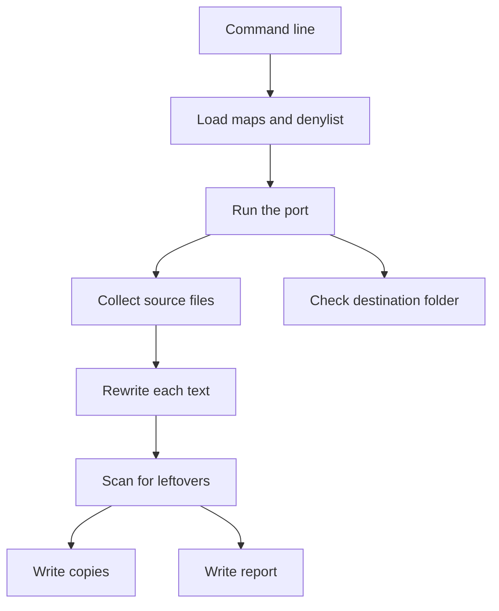
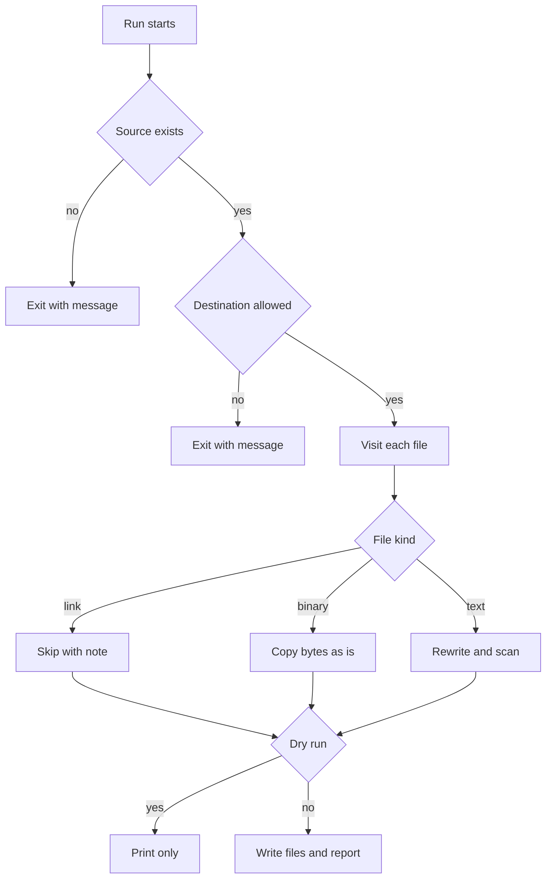

## Purpose

The port tool turns a private source file or folder into a copy that is safe to publish in the Tollgate repo. It swaps personal paths, ticket prefixes, skill prefixes and initials for neutral placeholders, replaces private terms from a deny list, removes AI attribution lines and dates in headers and change logs, and rewrites em dashes. Whatever it cannot fix with certainty (addresses, possible secrets, possible names) it lists by line number in a `leftovers.md` report for a person to fix by hand. The original is never edited.

## Dependencies

**Depends on.**
- `tools/port/mappings.json`, read on every run {src:tools/port/port.py:386}. It holds the default path, prefix and initials maps.
- Optional private files named by `--map` or `TOLLGATE_PORT_MAP`, and `--denylist` or `TOLLGATE_DENYLIST` {src:tools/port/port.py:379} {src:tools/port/port.py:381}.
- Standard library: argparse, json, os, re, shutil (imported, never used, see Notes), sys.
- Older page for the same tool: [[port]] / [port](../port.md).

**Used by.**
- Product code: none calls the functions. The launcher `tools/port/run.sh` starts it as a command {src:tools/port/run.sh:5}. Page: [[run]] / [run](run.md).
- Tests: `tools/port/tests/test_port.py` imports it {src:tools/port/tests/test_port.py:12}. Page: [[test_port]] / [test_port](tests/test_port.md).
- The leak scanner lists the source and test file as allowed fixtures for two of its rules {src:tests/leak/allowed_fixtures.txt:14} {src:tests/leak/allowed_fixtures.txt:15}.
- Searched with `git grep` for `tools/port`, `port.py` and `port/run` across the repo, excluding `docs/` (2026-11-20).

## Behavior

**Settings.** `main` loads `mappings.json`, merges the private map on top if given, loads the deny list, then calls `run` {src:tools/port/port.py:386} {src:tools/port/port.py:387} {src:tools/port/port.py:388} {src:tools/port/port.py:389}. `merge_config` keeps only four keys (paths, ticket prefixes, skill prefixes, initials); extra paths override, the other lists are appended without duplicates {src:tools/port/port.py:76} {src:tools/port/port.py:78} {src:tools/port/port.py:79} {src:tools/port/port.py:80} {src:tools/port/port.py:81} {src:tools/port/port.py:82}. The deny list skips blank lines and `#` lines {src:tools/port/port.py:93}, reads `term => replacement` or a bare term whose replacement is `Client A` {src:tools/port/port.py:95} {src:tools/port/port.py:96} {src:tools/port/port.py:98}, drops an entry whose replacement contains its own term {src:tools/port/port.py:99}, and puts longer terms first {src:tools/port/port.py:101}.

**The rewriter.** `Rewriter` compiles each rule once {src:tools/port/port.py:107} {src:tools/port/port.py:108} {src:tools/port/port.py:109} {src:tools/port/port.py:111} {src:tools/port/port.py:113} {src:tools/port/port.py:115}. For each line it applies, in order: paths (longest key first, not followed by a word character or hyphen) {src:tools/port/port.py:107} {src:tools/port/port.py:124} {src:tools/port/port.py:125}; ticket prefixes to `${TOLLGATE_TICKET_PREFIX}-` when a digit follows {src:tools/port/port.py:109} {src:tools/port/port.py:127}; skill prefixes to the fixed `tg-` {src:tools/port/port.py:129}; initials {src:tools/port/port.py:131}; then the deny list, case-insensitive {src:tools/port/port.py:115} {src:tools/port/port.py:133}.

**Rewriting a text.** `rewrite_text` goes line by line {src:tools/port/port.py:188}:
- A line matching the attribution pattern is dropped and its number recorded {src:tools/port/port.py:189} {src:tools/port/port.py:190} {src:tools/port/port.py:191}. The pattern matches `co-authored-by:` with an AI-style name, or "generated with/by" with an AI-style name {src:tools/port/port.py:31} {src:tools/port/port.py:32} {src:tools/port/port.py:33}.
- In the first 30 lines of a non-JSON file, the value after a `Date:` label is blanked {src:tools/port/port.py:192} {src:tools/port/port.py:193} {src:tools/port/port.py:196}.
- After a "change log" style heading, dates are stripped from following lines until the section ends: a Markdown heading ends it for `.md` files, and a line that is not a comment ends it for other files {src:tools/port/port.py:201} {src:tools/port/port.py:202} {src:tools/port/port.py:205} {src:tools/port/port.py:206} {src:tools/port/port.py:209} {src:tools/port/port.py:210} {src:tools/port/port.py:212}.
- The mapping rules and then em dash repair run on every remaining line, JSON included {src:tools/port/port.py:216} {src:tools/port/port.py:217}.

**Em dash repair.** An em dash at the start of text is removed {src:tools/port/port.py:158} {src:tools/port/port.py:159}. One at the end of text is removed {src:tools/port/port.py:163} {src:tools/port/port.py:164}. One between a lowercase letter, digit or closing bracket and a capitalised word becomes a period and a space {src:tools/port/port.py:167} {src:tools/port/port.py:169}. Any other becomes a comma and a space {src:tools/port/port.py:172} {src:tools/port/port.py:173}.

**Finding leftovers.** `find_leftovers` flags, per line: political words {src:tools/port/port.py:233}; a personal absolute path left over {src:tools/port/port.py:235}; an IP address other than `127.0.0.1` and `0.0.0.0` {src:tools/port/port.py:237} {src:tools/port/port.py:238}; an email not on the allow pattern {src:tools/port/port.py:241} {src:tools/port/port.py:242}; a host name not on the allow list {src:tools/port/port.py:245} {src:tools/port/port.py:246}, or a host-shaped name when no host name matched {src:tools/port/port.py:249} {src:tools/port/port.py:250}; a token or secret assignment {src:tools/port/port.py:252}; a name after a cue word such as "ask" or "thanks" {src:tools/port/port.py:254} {src:tools/port/port.py:256}; and an `@handle` in non-code files {src:tools/port/port.py:259}. It only flags; it never changes the text. Repeats are dropped {src:tools/port/port.py:261}.

**Running.** `run` works in this order.
1. Stop if the source is missing {src:tools/port/port.py:299} {src:tools/port/port.py:300}.
2. Stop if the destination is not inside the root (`--root`, default the repo root) {src:tools/port/port.py:20} {src:tools/port/port.py:301} {src:tools/port/port.py:302}, or if source and destination overlap either way {src:tools/port/port.py:303} {src:tools/port/port.py:304}. Both tests compare real paths {src:tools/port/port.py:293}.
3. Collect files: a single file, or a walk that skips `.git`, `__pycache__`, `.DS_Store` and `leftovers.md` {src:tools/port/port.py:21} {src:tools/port/port.py:279} {src:tools/port/port.py:280} {src:tools/port/port.py:283} {src:tools/port/port.py:285}.
4. Per file: symbolic links are skipped with a note {src:tools/port/port.py:308} {src:tools/port/port.py:309}; a file that is not valid UTF-8 is copied byte for byte with no rewrite and no leftover scan {src:tools/port/port.py:311} {src:tools/port/port.py:313} {src:tools/port/port.py:314}; any other file is rewritten and scanned {src:tools/port/port.py:316} {src:tools/port/port.py:317}. The file's permission bits are remembered {src:tools/port/port.py:312}.
5. Print one summary line per file and one line per leftover (file, line, reason, no content) {src:tools/port/port.py:319} {src:tools/port/port.py:321} {src:tools/port/port.py:322} {src:tools/port/port.py:323}.
6. In a dry run, stop here {src:tools/port/port.py:325} {src:tools/port/port.py:326} {src:tools/port/port.py:327}.
7. Otherwise write each file, after confirming its target is inside the destination {src:tools/port/port.py:331} {src:tools/port/port.py:332} {src:tools/port/port.py:333}, create folders, write the bytes and restore the permission bits {src:tools/port/port.py:334} {src:tools/port/port.py:336} {src:tools/port/port.py:337} {src:tools/port/port.py:338}. Last, write `leftovers.md` {src:tools/port/port.py:339} {src:tools/port/port.py:340} {src:tools/port/port.py:341}.

**The report.** `build_report` writes a table of leftovers (file, line, reason) and a list of removed or replaced items by source line {src:tools/port/port.py:349} {src:tools/port/port.py:353} {src:tools/port/port.py:362} {src:tools/port/port.py:365}. It states that no line content is repeated {src:tools/port/port.py:348}.

**Exit code.** `main` returns 0 {src:tools/port/port.py:390}. Leftovers do not change it. The refusal paths use `SystemExit` with a message, which exits non-zero {src:tools/port/port.py:300} {src:tools/port/port.py:302} {src:tools/port/port.py:304}.

## Diagram: module level (L2, required)

## Diagram: function level (L3, optional)

## Notes

**Code and description disagree.**
- The header says it "writes leftovers.md" {src:tools/port/port.py:6}. In a dry run the report is built but never written {src:tools/port/port.py:324} {src:tools/port/port.py:326} {src:tools/port/port.py:327}.
- The command-line help calls the destination "inside the Tollgate repo" {src:tools/port/port.py:378}. The real rule is "inside `--root`" {src:tools/port/port.py:301}, and `--root` can be set to any folder {src:tools/port/port.py:384}, so the guard can be moved by whoever runs the tool.
- The `Date:` header line is empty {src:tools/port/port.py:4}.
- `shutil` is imported but never used (searched the file for `shutil`, 2026-11-20) {src:tools/port/port.py:16}.
- Inside `fix_em_dashes` the variable `rep` is set and never read {src:tools/port/port.py:160}, and `len(after) > 0` is always true at that point {src:tools/port/port.py:167}.
- `run.sh` usage does not list `--root`, which the tool accepts {src:tools/port/run.sh:2} {src:tools/port/port.py:384}.

**Risks that the tool does not remove.**
- Possible secrets, addresses and names are only flagged. The flagged text is still written to the destination {src:tools/port/port.py:252} {src:tools/port/port.py:336}. The exit code stays 0 {src:tools/port/port.py:390}.
- A file that is not valid UTF-8 is copied with no scan at all {src:tools/port/port.py:313} {src:tools/port/port.py:314}.
- The attribution rule deletes the whole line from any file type, including code or text inside a multi-line string {src:tools/port/port.py:189} {src:tools/port/port.py:191}. Em dash repair also edits string literals in code and JSON {src:tools/port/port.py:217}.
- The permission bits are copied in full, including special bits {src:tools/port/port.py:312} {src:tools/port/port.py:338}.
- A symbolic link to a folder is neither walked nor reported; only symbolic links to files get the "symlink skipped" note {src:tools/port/port.py:283} {src:tools/port/port.py:308} {src:tools/port/port.py:309}.

**Inputs with no check on their value.**
- `source`: read in full; only existence is checked {src:tools/port/port.py:299} {src:tools/port/port.py:311}.
- `dest`: checked against the root only {src:tools/port/port.py:301} {src:tools/port/port.py:332}. Files in it with other names are overwritten without a prompt {src:tools/port/port.py:336}.
- `--root`, `--map`, `--denylist` and their environment variables: no check on the path or content {src:tools/port/port.py:379} {src:tools/port/port.py:381} {src:tools/port/port.py:384} {src:tools/port/port.py:70} {src:tools/port/port.py:90}. A bad map or deny list file ends the run with an unhandled Python error.
- Replacement text from the map and deny list is inserted into the output as given, with no check {src:tools/port/port.py:120} {src:tools/port/port.py:133}.
- No input reaches a shell command or a network address; the tool does neither.

**Writes to shared files.** Output files and `leftovers.md` are written in place with a plain open for writing, not atomically, and nothing stops two runs to the same destination at once {src:tools/port/port.py:336} {src:tools/port/port.py:340}. The tool never deletes: a file that was in the destination from an earlier run and is no longer in the source stays (searched the file for `unlink`, `remove` and `rmtree`, none found, 2026-11-20). Partial output is left if a run stops midway, because the report is written last {src:tools/port/port.py:340}.

**Constants.** The file defines 22 module-level constants (paths, skip names, the date and em dash patterns, and the leftover patterns). None is read by another file in the repo (searched `tools/port/tests/test_port.py` and the rest of the repo for attribute use, 2026-11-20).
